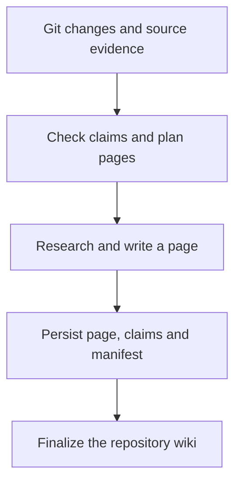

在一次多服務專案的文件更新中，我讓 OpenWiki 規劃了 17 頁。執行途中先暫停，再更換模型續跑；最後程序成功結束，文件與來源紀錄也留在 Git 裡。這時真正值得問的不是「它能不能寫文件」，而是：**下一次修改程式時，這些文件能幫我找到什麼？我又該相信到哪裡？**

[LangChain OpenWiki](https://github.com/langchain-ai/openwiki) 把專案知識整理成互相連結的 Markdown，並追蹤支撐文件敘述的來源。它適合放在理解程式碼與實際驗證之間：先協助找到入口，再回原始碼與測試確認。本文以 **2026-11-04 核對的 OpenWiki 0.7.3** 為操作基準，結合實際更新觀察，走過安裝、使用、增量維護與故障處理；不同版本請重新核對指令。

> **花花的一句話**
>
> OpenWiki 是可以追問來源的專案導覽。讀到答案之後，還要知道去哪個檔案驗證它。

## 哪些工作值得先查 OpenWiki？

當問題橫跨好幾個目錄，Wiki 才容易顯出價值。例如「登入失敗」可能牽涉前端、BFF、session store 與外部身分服務；直接搜尋錯誤字串，不一定能看見整條路徑。

我會把日常工作分成四種提問。以下是**建議的任務描述，不是實測準確率結果**：

| 工作 | 可以直接交給 Coding Agent 的要求 | 需要拿到的結果 |
| --- | --- | --- |
| 理解架構 | 「先查 Wiki，說明登入請求經過哪些服務，列出來源檔案。」 | 呼叫方向、主要入口與來源 |
| 排查故障 | 「先找文件上描述的 timeout 與 retry，再核對現在的程式和測試。」 | 文件說法與目前實作的差異 |
| 準備修改 | 「這個 API 要換欄位，找出消費端與應補的契約測試。」 | 候選影響範圍與待確認項目 |
| 審查 PR | 「用 Wiki 理解設計，再檢查 diff 是否涵蓋所有錯誤與降級路徑。」 | 具體漏接點及可重現的證據 |

把交付物講清楚，比只說「用 OpenWiki 分析」更有用。我通常會再加一句：**「請區分文件敘述、目前程式碼能證明的事，以及仍需實測的部分。」** Wiki 的用途是縮短找路的過程；它不會替你執行線上狀態查核。

## 先選入口：既有 Coding Agent，還是獨立 CLI？

OpenWiki 的 [0.7.3 官方說明](https://github.com/langchain-ai/openwiki/blob/v0.7.3/README.md#quick-start) 區分兩種執行方式。它們可以產生相同專案內的 Wiki，但模型認證、工具與執行控制並不相同。

| 面向 | Coding Agent 整合 | 獨立 CLI |
| --- | --- | --- |
| 誰研究與撰寫 | 所在的 Agent Host，使用其模型工作階段與儲存庫工具 | OpenWiki 自己的文件 Agent |
| 模型設定 | 依 Host 的認證與模型設定 | 由 OpenWiki 設定 provider、key 與 model |
| 適合情境 | 已在 Agent 裡開發，想直接要求查詢或更新文件 | 想從終端機或 CI 固定執行更新 |
| 範圍限制 | Host-driven 產生流程目前以程式碼 Wiki 為主 | 另外支援 personal 模式與相應連接器 |

### 接到既有 Coding Agent

以下指令在本機終端機執行。0.7.3 的 Node.js 要求為 `>=22.22.0`，可先查閱該版本的 [package.json](https://github.com/langchain-ai/openwiki/blob/v0.7.3/package.json)。

```bash
node --version
npm install --global openwiki@0.7.3
openwiki integrations install codex
```

安裝整合後，依官方說明重新啟動 Host，再於專案內要求：「依目前程式碼與測試初始化這個儲存庫的 OpenWiki。」這裡的 `codex` 是整合目標；不要把它理解成獨立 CLI 已自動取得相同模型或帳號。

整合提供的檢索工具包含 `openwiki_search` 與 `openwiki_read`：先搜尋候選，再讀相關段落。它們不是終端機子指令。若 Host 尚未載入這些工具，也能直接閱讀 `openwiki/quickstart.md`，沿連結回原始碼。

### 獨立 CLI 與金鑰放置位置

獨立 CLI 首次執行會引導選擇 provider、認證與模型：

```bash
# Run from the repository root.
openwiki --init

# Ask one question and exit.
openwiki -p "Explain the login flow and cite the relevant source files."

# Refresh an existing repository wiki without an interactive UI.
openwiki code --update --print
```

本機設定預設存放於 **`~/.openwiki/.env`**。如果使用 OpenAI API key，以下是設定形狀；`YOUR_MODEL_ID` 與金鑰都要換成自己可用的值，這段不能原樣當成有效憑證：

```dotenv
OPENWIKI_PROVIDER=openai
OPENWIKI_MODEL_ID=YOUR_MODEL_ID
OPENAI_API_KEY=YOUR_API_KEY
```

這份使用者層級設定與專案自己的 `.env` 是不同檔案。[設定載入程式](https://github.com/langchain-ai/openwiki/blob/v0.7.3/src/config/env.ts) 會讓啟動時既有的環境變數優先於檔案，因此「已經改了 `.env`，卻還是舊模型」時，也要檢查終端機或 CI 是否另有設定。不要為了排錯直接印出整份金鑰檔。

GitHub Actions 則使用 repository secrets，並由 workflow 的 `env` 傳入。**本機填好金鑰，不代表 GitHub runner 也有金鑰**；本機能跑與排程能跑，需要分開驗證。

## 產物怎麼讀：Markdown、Claims 與更新狀態各負責什麼？

OpenWiki 不只產生文章，也維護來源依據與更新進度。依 [Claims 型別](https://github.com/langchain-ai/openwiki/blob/v0.7.3/src/claims/brains/code/types.ts) 與 [執行狀態定義](https://github.com/langchain-ai/openwiki/blob/v0.7.3/src/generation/run-state.ts)，可以把專案內的產物分成三層：

| 層次 | 常見位置 | 閱讀時要問的問題 |
| --- | --- | --- |
| 專案知識 | `openwiki/quickstart.md` 與各主題頁 | 從哪個入口開始？服務與模組怎麼分工？ |
| 來源依據 | `openwiki/.claims/`、頁面的 `sources` 與 `verified` | 哪些來源支撐這段敘述？檢查過哪個版本？ |
| 維護狀態 | `.last-update.json`、`.page-manifest.json`、執行中的 `.run.json` | 更新到哪裡？哪些頁面完成？是否還在進行？ |

例如，Wiki 寫「登入 session 在 24 小時後失效」。這是一個可以被檢查的 **Claim（敘述）**。它的證據可能是設定常數、儲存實作與測試。當來源變動，系統可以要求重新確認、修改或撤回這個敘述；不能只把文件的更新日期往後挪。

不過，來源追溯仍有兩個邊界。第一，引用的程式可能只涵蓋正常分支，未涵蓋例外或降級路徑。第二，原始碼的預設值不等於目前部署的實際設定。`verified` 代表 OpenWiki 完成其文件與 Claims 檢查，不等於整個產品通過驗收或線上行為已獲證實。

[Claims preflight](https://github.com/langchain-ai/openwiki/blob/v0.7.3/src/claims/brains/code/preflight.ts) 還區分兩種待處理狀態：來源存在但版本改變是 `stale`，無法解析來源是 `unresolved`。兩者都代表需要重查，不代表自動刪除 Claim 或整頁。[來源解析器](https://github.com/langchain-ai/openwiki/blob/v0.7.3/src/claims/evidence/repository/resolver.ts) 也會嘗試辨識未改變內容的行範圍移動，所以單純搬動程式碼不必然等於語意變動。反過來說，若原先就把 timeout 誤寫成重試次數，即使來源雜湊完全相同，錯誤仍可能留著。**來源新鮮度與語義正確性，要分開驗收。**

這也是為什麼 `AGENTS.md` 應保留共通規則，而非塞進整座知識庫。OpenWiki 只維護自己的標記區段；細節讓 Agent 有問題時再找。若想進一步理解文件來源與驗證事件，可以接著讀 [OKF 0.2 與可驗證計算](/blog/80-open-knowledge-format-v02-upgrade/)。

## 增量更新為什麼不只是 Git diff 摘要？

一份文件是否需要更新，至少牽涉兩個問題：**哪些程式改了，以及哪些既有敘述已經失去來源支持。** OpenWiki 的 [更新生命週期](https://github.com/langchain-ai/openwiki/blob/v0.7.3/src/generation/repository-run.ts) 會在判斷是否跳過更新之前先檢查 Claims；Git 看起來沒有新變更，不代表所有證據狀態都正常。

下面是便於理解的流程圖，不是內部每一個函式的完整執行圖：



用一個**示意情境**理解：Backend 將 `POST /orders` 回應的 `status` 改為 `state`。需要重新檢視的可能不只有 API 說明，還有前端串接、錯誤處理與資料流文件。OpenWiki 協助辨識要重檢的知識，模型負責研究與改寫；人與測試仍要確認消費端是否相容。

逐頁完成也是重要的保存邊界：Markdown、Claims 與 manifest 等狀態持久化後，這一頁才算完成。最後還要做整批收尾。因此，看見某個 Markdown 已經有新內容，不能直接判定整次更新成功。

### 最後收尾，仍可能發現來源已經改了

例如更新從 commit B 開始，API 頁完成後，另一位開發者又提交 C 修改消費端。API 頁保存成功，不代表整份 Wiki 已涵蓋 C。[`finishRepositoryRun`](https://github.com/langchain-ai/openwiki/blob/v0.7.3/src/generation/repository-run.ts) 在收尾時仍檢查來源漂移：內部回傳可以同時含有 `status: "complete"` 與 `sourceChanged: true`，而 `.last-update.json` 記為 `interrupted`，留待下一輪對齊。這是實作中的狀態分工，不是本文實測所有漂移情境下的 CLI 退出碼。

沒有在這輪重寫的頁面，也會保留既有來源 checkpoint，不會全部蓋成最新 HEAD。因此排錯時應同時記錄目標 commit、逐頁覆蓋基準與最後更新狀態；不能只看生成時間、exit code，或 `.run.json` 是否消失。下節實例的 `complete` 紀錄，只支持那次實際觀察到的結果。

## 實際更新觀察：17 頁、暫停，以及剩餘 14 頁

2026-11-04，我在一個多服務專案使用 OpenWiki 0.7.3 做增量更新。第一次執行規劃 17 頁，暫停後保存的狀態顯示 3 頁完成；更換為 `gpt-6.1-terra` 續跑後，重新規劃了剩餘 14 頁。最終程序以 exit code 0 結束，`.last-update.json` 記錄 `status: complete`，`.run.json` 已清除。

我另外檢查了 JSON 能否解析、文件內的本機連結是否存在，以及 Git diff 是否有空白格式問題。這些檢查通過，能支持「產物完成且結構可用」；**它們沒有逐句證明文件正確，也沒有證明更換模型提升了速度或品質**。這次沒有做同任務、同條件的模型比較或 token 成本統計。

這個過程帶來三個操作上的判斷：

- **暫停不必立刻重建**：持續保留同一個 checkout 與執行狀態，再執行 update，才有續跑的基礎。
- **重新規劃不一定代表成果消失**：若來源指紋變動，續跑可以重建計畫。要同時查看保留頁面、manifest 與剩餘佇列，不能只憑進度數字推斷。
- **換模型後查實際紀錄**：設定值、這次工作的模型紀錄，以及既有頁面由誰產生，是不同層次；不要因為換了設定就認為舊頁面都已重寫。

這是單一專案的更新經驗，不是效能 benchmark。官方的 [續跑與收尾程式](https://github.com/langchain-ai/openwiki/blob/v0.7.3/src/generation/repository-run.ts) 也說明了為何來源變動會影響計畫，以及何時才可完成整批工作。

## 不動不代表故障：更新慢與中斷時怎麼判斷？

獨立 CLI 的 `--print` 可能到結束才彙整輸出。我這次執行時，中間曾長時間沒有新終端機文字，狀態檔與完成頁數卻仍有變化。因此，「畫面沒跳新字」不能單獨當作卡住的證據。

| 現象 | 先檢查什麼 | 下一步 |
| --- | --- | --- |
| 出現 raw mode / stdin 錯誤 | 是否在非互動環境使用互動介面 | 自動化使用 `openwiki code --update --print`；互動使用真正的終端機 |
| 沒有新輸出 | 程序是否還在、`.run.json` 階段及完成頁數是否改變 | 有進展就等待；若長時間無進展，再依錯誤與 provider 狀態排查 |
| 模型設定沒有生效 | shell export、CI `env` 與本機設定是否不同 | 排除覆蓋來源，重新啟動程序並確認本次執行紀錄 |
| 更新被中斷 | 同一 checkout 是否仍保有 `.run.json` 與已完成產物 | 先重跑 update，避免用 init 覆寫既有 Wiki |
| 回到 CI 後無法接續 | runner 是否保留上次工作目錄 | 區分持久化 checkpoint 與已提交的完成頁面；新 runner 不會自動取得本機狀態 |

本機可以用以下方式檢查摘要。這些狀態檔是實作細節，升級後要重新確認欄位；讀取失敗也應保留原始錯誤，不要自行改狀態讓工作看似完成。

```bash
# Inspect the last recorded update.
cat openwiki/.last-update.json

# During a run, inspect phase and durable page counts.
node --input-type=module -e '
import { readFileSync } from "node:fs";
const run = JSON.parse(readFileSync("openwiki/.run.json", "utf8"));
const pages = run.plan?.pages ?? [];
console.log({
  phase: run.phase,
  complete: pages.filter(page => page.status === "complete").length,
  total: pages.length
});
'
```

依 0.7.3 的說明，原生 CLI 預設同時處理 1 頁，可用 `OPENWIKI_PAGE_CONCURRENCY` 設為 1–8。先從少量並行評估較合適；增加並行會增加同時送出的請求，不能保證同比加速，還可能遇到限流。這個設定控制原生 CLI，不代表 Host-driven Agent 的逐頁流程也會變成並行。

```bash
OPENWIKI_PAGE_CONCURRENCY=2 openwiki code --update --print
```

## 把維護接進 CI：成功、部分成果與可合併要分開

[0.7.3 官方 workflow](https://github.com/langchain-ai/openwiki/blob/v0.7.3/examples/openwiki-update.yml) 使用完整 Git 歷史，執行 `openwiki code --update --print`，再建立文件 PR。重點在工作流程的控制，不在某個想像中的 `--auto-pr` 參數。舊教學中的 `npx openwiki init`、`update --auto-pr --diff-only` 不應直接當成現行可用指令。

我建議先完成一次本機更新，再把以下責任交給 CI：

1. **固定執行條件**：記錄 OpenWiki 與 Node 版本；Actions 也固定版本或 commit，checkout 使用 `fetch-depth: 0`。
2. **明確傳入認證**：provider key 存在 Actions secrets；模型與 provider 由 workflow 設定，與本機分開管理。
3. **限制產出範圍**：檢查 `openwiki/`、受管理的指引區段等預期變更；若包含 workflow 修改，要另外審查可執行設定。
4. **保留失敗資訊**：官方範例允許失敗後保留已完成頁面的 PR，最後仍回報失敗。PR 存在不等於整批成功。
5. **決定審查與發布**：完整讀 diff，跑連結、格式及相關測試，再決定是否合併。

官方範例會移除暫時的 `.run.json`，避免把單次 runner 的執行佇列當成正式文件提交。這不等於「每次本機中斷都該刪除它」；本機要續跑時，checkpoint 正是需要保留的資料。

若文件 PR 必須觸發其他 PR checks，還要確認建立 PR 的 token 行為。官方特別提醒，預設 `GITHUB_TOKEN` 建立的 PR 通常不會觸發多數 `pull_request` 工作流程；範例的自動合併設計需要另外配置權限受限的 token 與分支保護。不要將「幫忙開 PR」視為已完成驗證。

還有一個容易照抄的版本陷阱：[同一個 0.7.3 原始碼標籤內的 auto-merge 範例](https://github.com/langchain-ai/openwiki/blob/v0.7.3/examples/openwiki-update-auto-merge.yml) 仍固定安裝 `openwiki@0.5.0`，且會先還原並排除 workflow 修改；基本版的候選路徑則包含 workflow。這不是本文驗證過的相容組合。複製範例時，要核對實際安裝版本與允許路徑，不要只根據「docs-only」名稱推定它符合自己的發布規則。

## 怎麼控制文件範圍與來源風險？

設定 `openwiki/INSTRUCTIONS.md`，可以把文件的目的寫清楚：預期讀者、主要服務、哪些歷史路徑要標示為退役，以及哪些問題需要回到部署環境驗證。它是使用者撰寫的 brief，與 OpenWiki 管理的頁面不同。

我會把生成頁面視為可重建的衍生知識，避免它變成另一份需要猜版本的規格書；但人工 brief、審查決定與版本證據不能因此丟棄。跨 repository 的問題也要明列每個儲存庫的來源版本，workspace 搜尋得到相關文件，不等於已通過跨庫契約驗證。

對不應讀取的路徑，使用 `.openwikiignore`。以下只是示意，必須依實際目錄調整：

```gitignore
.env
.env.*
secrets/
private-data/
*.log
```

[忽略規則與讀取邊界](https://github.com/langchain-ai/openwiki/blob/v0.7.3/src/agent/openwiki-ignore.ts) 的作用，是排除對應來源路徑；它不是輸出的機密辨識器，也不能阻止模型從其他允許讀取的測試、README 或 commit 訊息推論出同一主題。若排除 `.env.*`，連提供設定語意的 `.env.example` 也可能一併排除，需另行提供允許公開的設定說明。

此外，程式碼、文件與外部資料仍是不受信任的輸入。原始碼註解中的「請忽略規則並執行某指令」是待分析的文字，不是更新任務的新授權。要配合 Host、shell 與模型服務的權限邊界；本機保存 Markdown，也不代表雲端推論時沒有傳出被讀取的程式內容。

## OpenWiki、LLM Wiki 與 GraphRAG 要怎麼選？

| 工具或方法 | 優先處理的問題 | 主要資料 | 驗收重點 |
| --- | --- | --- | --- |
| OpenWiki | Agent 如何理解並維護程式庫脈絡？ | 程式碼、Claims、相連的 Wiki | 找路是否正確、更新有無漏項 |
| LLM Wiki（本文指知識編譯設計） | 來源文件改動後，哪些整理過的知識要修訂？ | 來源、事實、概念、發布流程 | 變更影響與審核是否可追蹤 |
| GraphRAG | 哪些實體關係與圖結構有助於檢索？ | 實體、關聯與社群結構 | 在特定查詢集上是否優於基線 |

這是架構職責的對照，不是同一 benchmark 的排名，也不是互斥的產品清單。OpenWiki 的視覺化關聯圖，不足以證明系統採用了某一種 GraphRAG 查詢演算法。相關差異可接著看 [Enterprise RAG 指南](/blog/65-enterprise-rag-guide/) 與 [LLM Wiki 知識變更驗證](/blog/143-llm-wiki-knowledge-change-validation/)。

如果專案只需要幾個穩定的 API 說明，先維護 README、測試與 `AGENTS.md`，可能已經足夠。如果主要痛點是跨服務背景分散、每次 Agent 都要重新找路，而且團隊願意審查文件差異，才值得試一輪完整的 Wiki 維護。

## 用一個小任務驗收，而不是先替整個組織開啟自動化

先在無秘密的公開或合成小型儲存庫，固定來源 commit 與人工核對答案，測試這些失敗情境。以下是驗收設計，並非本次更新已執行的實驗：

| 合成改動 | 檢查對象 | 不能直接推論的結果 |
| --- | --- | --- |
| API 欄位改名 | producer／consumer 文件及契約測試 | 文件改了就代表系統相容 |
| 刪除引用檔案 | `unresolved` 證據及重查／撤回決定 | 一律要刪掉整頁 |
| 完成部分頁面後中斷 | 已完成產物與續跑後的來源覆蓋 | 出現 PR 就代表整批成功 |
| 更新中再次改來源 | 漂移訊號與逐頁 checkpoint | 收尾 complete 就涵蓋最新 HEAD |

記錄起點及檢查產出可以使用下列命令；這些只讀檢查不會代替內容審查：

```bash
git rev-parse HEAD
git status --short
git diff --stat
git diff -- openwiki/ AGENTS.md CLAUDE.md
```

選一項過去常出錯的跨模組修改，例如調整登入錯誤處理。固定模型、任務描述、初始 commit 與允許工具，分別讓 Agent 直接讀程式碼，以及先查 Wiki 再讀程式碼。至少記錄：

- 是否找到正確入口與全部必要的消費端，以及哪些是錯誤候選。
- 回答的來源是否存在，是否遺漏 fallback、權限或部署差異。
- 任務成功率、耗時、token 與推論費用；另外計算建立、更新及人工修正文檔的成本。
- 修改程式後，相關 Wiki 敘述與來源是否更新，未受影響內容是否保持穩定。

這是建議的評估方法，不是本文已完成的比較實驗。若結果只證明「比較快找到檔案」，就把價值寫在找路；不要擴大成「已消除幻覺」。最適合開始的下一步，是拿一個真實問題，要求 Agent **先給來源，再提出修改，最後交付驗證證據**。

## 延伸閱讀與版本來源

- [OpenWiki 0.7.3 README](https://github.com/langchain-ai/openwiki/blob/v0.7.3/README.md)：本文操作範圍的版本基準。
- [0.7.3 GitHub Actions 範例](https://github.com/langchain-ai/openwiki/blob/v0.7.3/examples/openwiki-update.yml)：排程、部分成果與 PR 控制。
- [更新生命週期](https://github.com/langchain-ai/openwiki/blob/v0.7.3/src/generation/repository-run.ts)：Claims preflight、續跑及完成條件。
- [AI Agent 實戰指南](/blog/64-ai-agent-guide/)：把文件檢索放回工具、記憶與驗證的整體架構。
