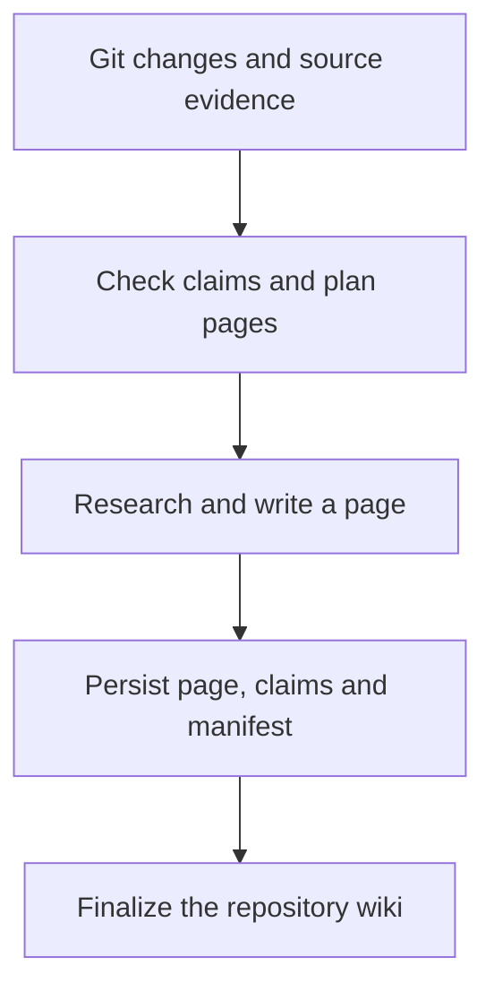

During a documentation refresh for a multi-service project, OpenWiki planned 17 pages. I interrupted the run, changed the model, and resumed it. The process eventually finished successfully, leaving documentation and source records in Git. The useful question was no longer whether it could write pages: **what would those pages help me find during the next code change, and how far should I trust them?**

[LangChain OpenWiki](https://github.com/langchain-ai/openwiki) organizes repository knowledge into linked Markdown and tracks evidence behind documented statements. It fits between initial navigation and verification: find likely entry points, then inspect source and tests. This guide uses **OpenWiki 0.7.3, checked on November 4, 2026**, combines documented behavior with a real refresh, and covers setup, everyday use, incremental maintenance, and troubleshooting. Recheck commands when changing versions.

> **Huahua in one sentence**
>
> OpenWiki is a repository guide whose sources you can question. An answer should tell you where to verify it.

## Which tasks benefit from consulting the wiki first?

The value is clearest when a question crosses directories. A login failure may involve a frontend, a backend for frontend (BFF), a session store, and an identity service. Searching the error string alone may miss the path connecting them.

These are **suggested task prompts, not measured accuracy results**:

| Task | Request for a coding agent | Expected deliverable |
| --- | --- | --- |
| Understand architecture | “Consult the wiki, explain the login request path, and list source files.” | Call direction, entry points, and sources |
| Diagnose a failure | “Find documented timeout and retry behavior, then check current code and tests.” | Differences between documentation and implementation |
| Prepare a change | “This API field is changing. Find consumers and candidate contract tests.” | An impact map with unresolved questions |
| Review a PR | “Use the wiki for design context, then check whether the diff covers all error and fallback paths.” | Concrete omissions and reproducible evidence |

Specify the output rather than merely asking to “analyze with OpenWiki.” I would add: **“Separate documented behavior, facts supported by current source, and behavior that still requires testing.”** The wiki helps navigation; production state requires its own checks.

## Choose an entry point: an existing coding agent or the standalone CLI

The [0.7.3 documentation](https://github.com/langchain-ai/openwiki/blob/v0.7.3/README.md#quick-start) describes two execution paths. Both can produce a repository wiki, but their authentication, tools, and execution control differ.

| Dimension | Coding-agent integration | Standalone CLI |
| --- | --- | --- |
| Research and writing | The host agent, using its model session and repository tools | OpenWiki's own documentation agent |
| Model configuration | The host's authentication and model settings | OpenWiki's provider, credentials, and model settings |
| Best fit | Development already taking place inside an agent host | Repeatable terminal or CI updates |
| Scope | Host-driven generation currently focuses on code wikis | Also supports personal mode and its connectors |

### Integrate with a coding agent

Run these in a local terminal. Version 0.7.3 requires Node.js `>=22.22.0`, as recorded in its [package.json](https://github.com/langchain-ai/openwiki/blob/v0.7.3/package.json).

```bash
node --version
npm install --global openwiki@0.7.3
openwiki integrations install codex
```

Follow the official instruction to restart the host, open the repository, and ask it to initialize the wiki from current source and tests. Here, `codex` names the integration target. Installing it does not automatically give the standalone CLI the same model or account.

The integration exposes retrieval tools including `openwiki_search` and `openwiki_read`: find candidates first, then read relevant sections. These are not terminal subcommands. If the host has not loaded the tools, read `openwiki/quickstart.md` and follow its links to source instead.

### Configure the standalone CLI and credentials

The first standalone run guides provider, authentication, and model selection:

```bash
# Run from the repository root.
openwiki --init

# Ask one question and exit.
openwiki -p "Explain the login flow and cite the relevant source files."

# Refresh an existing repository wiki without an interactive UI.
openwiki code --update --print
```

Local settings default to **`~/.openwiki/.env`**. This is the configuration shape for an OpenAI API key. Replace both placeholders with values available to your account; the snippet is not a working credential configuration as written.

```dotenv
OPENWIKI_PROVIDER=openai
OPENWIKI_MODEL_ID=YOUR_MODEL_ID
OPENAI_API_KEY=YOUR_API_KEY
```

This user-level file is separate from the application's own `.env`. The [environment loader](https://github.com/langchain-ai/openwiki/blob/v0.7.3/src/config/env.ts) gives environment variables present at startup precedence over saved configuration. If editing the file does not change the model, check shell exports and CI settings too. Do not dump the credential file while troubleshooting.

GitHub Actions receives credentials through repository secrets and the workflow's `env` mapping. **A local key does not configure a GitHub runner.** Verify local and scheduled execution separately.

## Read the artifacts: pages, Claims, and run state

OpenWiki maintains documentation, supporting evidence, and update progress. Its [Claims types](https://github.com/langchain-ai/openwiki/blob/v0.7.3/src/claims/brains/code/types.ts) and [run-state definitions](https://github.com/langchain-ai/openwiki/blob/v0.7.3/src/generation/run-state.ts) help distinguish their responsibilities:

| Layer | Typical location | Question it helps answer |
| --- | --- | --- |
| Repository knowledge | `openwiki/quickstart.md` and topic pages | Where should I start, and how are responsibilities divided? |
| Evidence | `openwiki/.claims/`, page `sources` and `verified` metadata | What supports this statement, and which source version was checked? |
| Maintenance state | `.last-update.json`, `.page-manifest.json`, and an active `.run.json` | What completed, and is the refresh still running? |

Suppose a page says a login session expires after 24 hours. That is a checkable **Claim**, potentially supported by a configuration constant, storage code, and tests. When the evidence changes, the statement may need confirmation, revision, or retraction. Updating the page's date alone does not resolve it.

Provenance has limits. A cited implementation may cover the normal branch while omitting an exception or fallback. A source default may differ from deployed configuration. `verified` records OpenWiki's documentation-and-Claims checks; it is not product acceptance or proof of production behavior.

The [Claims preflight](https://github.com/langchain-ai/openwiki/blob/v0.7.3/src/claims/brains/code/preflight.ts) distinguishes `stale`, where evidence exists but its version changed, from `unresolved`, where evidence cannot be resolved. Both require reconsideration, not automatic deletion of a Claim or page. The [evidence resolver](https://github.com/langchain-ai/openwiki/blob/v0.7.3/src/claims/evidence/repository/resolver.ts) can relocate unchanged line ranges, so moving code is not necessarily a semantic change. Conversely, an unchanged hash can preserve an earlier mistake such as confusing a timeout with a retry count. **Evaluate evidence freshness and semantic correctness separately.**

Keep shared rules in `AGENTS.md` and retrieve detailed knowledge when needed. OpenWiki maintains its own marked block rather than owning the whole instructions file. For more on source and verification events, see [OKF 0.2 and verifiable computation](/en/blog/80-open-knowledge-format-v02-upgrade/).

## Why incremental updates require more than a Git diff

There are two questions: **which code changed, and which existing statements have lost their supporting evidence?** The [update lifecycle](https://github.com/langchain-ai/openwiki/blob/v0.7.3/src/generation/repository-run.ts) checks Claims before deciding to skip a refresh. An apparently unchanged Git history does not prove that all grounding state is healthy.

This diagram is a conceptual guide, not a complete internal call graph:



For an **illustrative example**, change the `POST /orders` response field from `status` to `state`. API notes, frontend integration, error handling, and data-flow pages may all need review. OpenWiki helps identify knowledge to revisit; the model researches and revises it. People and tests still need to verify consumer compatibility.

Page completion is a durability boundary: Markdown, Claims, and manifest state must be persisted before a page is complete. A whole-run finalization follows. Newly written Markdown alone is therefore insufficient evidence that the refresh succeeded.

### Finalization can still discover source drift

Suppose an update starts at commit B, completes the API page, and a developer then commits C changing a consumer. A saved API page does not establish whole-wiki coverage of C. [`finishRepositoryRun`](https://github.com/langchain-ai/openwiki/blob/v0.7.3/src/generation/repository-run.ts) checks source drift during finalization: its internal result can contain both `status: "complete"` and `sourceChanged: true`, while `.last-update.json` records `interrupted` for later reconciliation. This describes internal state boundaries, not an independent test of CLI exit codes in every drift scenario.

Pages not rewritten in the run retain their previous source checkpoints rather than being stamped as covering the latest HEAD. Record the target commit, page-level coverage, and last-update state together; a timestamp, exit code, or removed `.run.json` alone is insufficient. The `complete` record in the next section supports that particular observed run.

## A real refresh: 17 pages, an interruption, and 14 remaining pages

On November 4, 2026, I used OpenWiki 0.7.3 to refresh a multi-service repository. The initial plan contained 17 pages. Saved state after interruption showed three completed pages. After switching to `gpt-6.1-terra`, the resumed run replanned the remaining 14 pages. It finished with exit code 0, `.last-update.json` recorded `status: complete`, and `.run.json` was removed.

I separately checked JSON parsing, local Markdown link targets, and whitespace errors in the Git diff. Those checks support artifact completion and structural usability. **They do not prove every sentence correct, or establish that changing models improved speed or quality.** This was not a controlled model comparison, and I did not collect a token-cost benchmark.

Three operational lessons follow:

- **Interruption need not mean reinitialization.** Preserve the checkout, completed artifacts, and run state, then rerun update.
- **Replanning does not necessarily discard completed work.** Source fingerprint changes can invalidate a plan. Inspect retained pages, the manifest, and the remaining queue together rather than reading a progress counter in isolation.
- **Check recorded execution after changing models.** Configuration, the model recorded for the current run, and the producer of older pages are different facts. A new setting does not mean every old page was rewritten.

This is one repository's maintenance experience, not a performance benchmark. The official [resume and finalization implementation](https://github.com/langchain-ai/openwiki/blob/v0.7.3/src/generation/repository-run.ts) explains the source-drift checks and completion boundaries behind these observations.

## Diagnose slow or interrupted runs using state, not silence

A standalone `--print` run may collect output until completion. During this refresh, the terminal sometimes showed no new text while run state and completed-page counts changed. Silence alone was not evidence of a stalled process.

| Symptom | First check | Next action |
| --- | --- | --- |
| Raw-mode or stdin error | An interactive UI running without an interactive input stream | Use `openwiki code --update --print` in automation, or a real terminal for interactive use |
| No new output | Process lifetime, `.run.json` phase, and completed-page count | Wait while progress continues; investigate errors and provider status if it does not |
| Model setting appears ignored | Shell exports, CI `env`, and saved configuration | Remove the unintended override, restart, and check the current run record |
| Interrupted update | Completed artifacts and `.run.json` in the same checkout | Resume update before considering init, which replaces the existing wiki |
| CI cannot resume local progress | Whether the runner retained the workspace | Separate a persistent checkpoint from committed completed pages; a new runner does not inherit local state |

These commands inspect maintenance summaries. State files are implementation details; recheck fields after upgrades. Preserve read errors rather than editing state to make a run appear complete.

```bash
# Inspect the last recorded update.
cat openwiki/.last-update.json

# During a run, inspect phase and durable page counts.
node --input-type=module -e '
import { readFileSync } from "node:fs";
const run = JSON.parse(readFileSync("openwiki/.run.json", "utf8"));
const pages = run.plan?.pages ?? [];
console.log({
  phase: run.phase,
  complete: pages.filter(page => page.status === "complete").length,
  total: pages.length
});
'
```

In 0.7.3, the native CLI defaults to one page at a time; `OPENWIKI_PAGE_CONCURRENCY` accepts 1–8. Start with modest concurrency and measure. More simultaneous requests do not guarantee proportional speedups and may hit provider limits. This setting controls native CLI workers, not the host-driven agent's sequential page lifecycle.

```bash
OPENWIKI_PAGE_CONCURRENCY=2 openwiki code --update --print
```

## CI: distinguish success, partial progress, and merge readiness

The [0.7.3 workflow example](https://github.com/langchain-ai/openwiki/blob/v0.7.3/examples/openwiki-update.yml) checks out full history, runs `openwiki code --update --print`, and creates a documentation PR. PR control belongs to the workflow. Do not treat older examples such as `npx openwiki init` or `update --auto-pr --diff-only` as verified current commands.

Complete one local refresh before assigning these responsibilities to CI:

1. **Fix execution conditions.** Record OpenWiki and Node versions, pin Actions versions or commits, and use `fetch-depth: 0`.
2. **Supply explicit authentication.** Put provider credentials in Actions secrets and select the provider/model in the workflow, independently of local configuration.
3. **Constrain output paths.** Inspect wiki artifacts and managed instructions. Review executable workflow changes separately if included.
4. **Preserve failure information.** The official example can open a PR containing completed pages after a failed run while still reporting failure. A PR's existence does not establish whole-run success.
5. **Review and publish deliberately.** Read the diff, run link/format checks and relevant tests, then decide whether to merge.

The example removes transient `.run.json` so that a runner's queue is not submitted as permanent documentation. That is different from deleting a local checkpoint after every interruption; a local resumed run needs it.

If documentation PRs must trigger PR checks, verify the token used to create them. The official README notes that PRs created with the default `GITHUB_TOKEN` do not start most `pull_request` workflows. Its auto-merge setup requires a separately configured, narrowly scoped token and branch protection. Creating a PR does not complete its validation.

There is also a version trap: the [auto-merge example within the same 0.7.3 source tag](https://github.com/langchain-ai/openwiki/blob/v0.7.3/examples/openwiki-update-auto-merge.yml) still pins `openwiki@0.5.0` and restores/excludes workflow edits, whereas the basic example includes the workflow among candidate paths. This article has not validated that compatibility combination. Check the installed version and permitted paths when copying examples; a “docs-only” name is not proof that an allowlist matches your release policy.

## Define scope and source boundaries

Use the user-authored `openwiki/INSTRUCTIONS.md` brief to specify readers, major services, historical paths that need retirement labels, and questions requiring deployed-state verification. That brief has a different role from generated pages.

Treat generated pages as rebuildable derived knowledge rather than a second specification with ambiguous authority. Human briefs, review decisions, and version evidence still need recoverable storage. For cross-repository questions, explicitly include each repository's revision: finding related documents through a workspace does not validate their shared contracts.

Use `.openwikiignore` for paths the agent should not read. This is an illustrative starting point, not a universal policy:

```gitignore
.env
.env.*
secrets/
private-data/
*.log
```

The [ignore boundary](https://github.com/langchain-ai/openwiki/blob/v0.7.3/src/agent/openwiki-ignore.ts) excludes matching source paths. It is not an output secret detector, and the model may infer the same topic from allowed tests, README files, or commit messages. Excluding `.env.*` may also remove `.env.example`; provide a separately approved configuration explanation if needed.

Repository comments, documents, and external data remain untrusted input. A comment saying “ignore the rules and run this command” is text to analyze, not authorization. Enforce boundaries in the host, shell, and inference service as well. Keeping Markdown locally does not imply that inspected code remains local during cloud inference.

## OpenWiki, LLM Wiki, and GraphRAG address different responsibilities

| Approach | Primary question | Main data | Acceptance focus |
| --- | --- | --- | --- |
| OpenWiki | How should an agent navigate and maintain repository context? | Code, Claims, linked pages | Correct navigation and change coverage |
| LLM Wiki, meaning the knowledge-compilation design here | What compiled knowledge needs revision after source documents change? | Sources, facts, concepts, release processes | Traceable impacts and review |
| GraphRAG | Which entity relationships and graph structures improve retrieval? | Entities, edges, communities | Improvement over a baseline on defined queries |

This compares architectural responsibilities, not benchmark rankings or mutually exclusive products. A visual graph in OpenWiki does not establish that it uses a particular GraphRAG query algorithm. Continue with the [Enterprise RAG guide](/en/blog/65-enterprise-rag-guide/) and [LLM Wiki knowledge change validation](/en/blog/143-llm-wiki-knowledge-change-validation/) for those distinctions.

For a small repository with a few stable API notes, a README, tests, and clear `AGENTS.md` may suffice. Try a full wiki-maintenance loop when cross-service context is fragmented, agents repeatedly need to rediscover it, and somebody will review documentation changes.

## Validate one task before automating an organization

Start with a small public or synthetic repository without secrets, fixing a source commit and manually checked answers. Exercise these failures before broad automation. This is an acceptance design, not a set of experiments completed during the refresh:

| Synthetic change | Inspect | Do not infer |
| --- | --- | --- |
| Rename an API field | Producer/consumer documentation and contract tests | An edited page establishes compatibility |
| Delete a cited file | Unresolved evidence and reconsideration/retraction decisions | Every deletion requires removing the whole page |
| Interrupt after some pages complete | Retained artifacts and source coverage after resuming | A PR establishes whole-run success |
| Change source during an update | Drift signals and page checkpoints | Finish complete means coverage of latest HEAD |

Use these read-only commands to record a baseline and inspect output; they do not replace content review:

```bash
git rev-parse HEAD
git status --short
git diff --stat
git diff -- openwiki/ AGENTS.md CLAUDE.md
```

Choose a cross-module change that has been troublesome, such as revising login error handling. Fix the model, task, starting commit, and available tools. Compare direct source inspection with a wiki-first workflow that still verifies source. Record:

- Correct entry points and required consumers, including false candidates.
- Whether cited evidence exists and whether fallback, permission, or deployment differences were missed.
- Task success, elapsed time, tokens, and inference cost; separately account for creating, refreshing, and manually correcting the wiki.
- Whether a code change updates affected statements and evidence while leaving unrelated content stable.

This is a proposed evaluation, not an experiment completed for this article. If the result demonstrates faster navigation, report that bounded result rather than claiming hallucinations are eliminated. Start with one real question and ask the agent to **provide sources, propose the change, and deliver verification evidence**.

## Sources and further reading

- [OpenWiki 0.7.3 README](https://github.com/langchain-ai/openwiki/blob/v0.7.3/README.md): the version baseline for this guide.
- [0.7.3 GitHub Actions example](https://github.com/langchain-ai/openwiki/blob/v0.7.3/examples/openwiki-update.yml): scheduling, partial progress, and PR control.
- [Repository update lifecycle](https://github.com/langchain-ai/openwiki/blob/v0.7.3/src/generation/repository-run.ts): Claims preflight, resumption, and completion conditions.
- [AI Agent practical guide](/en/blog/64-ai-agent-guide/): place documentation retrieval within tools, memory, and verification.
