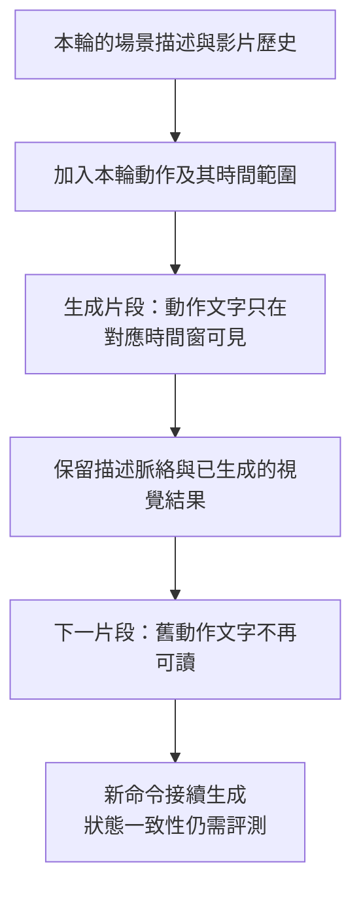

<!-- paper-reading-no-body-figures: Source-figure inventory for arXiv:2610.36729v1 (Figures 1–21), checked 2026-10-29: no confirmed reuse grant covering the material paper figures was located in the paper, arXiv license or official repository license. No original-paper images are reproduced; original mechanism diagrams are explanatory only, not source evidence. This records unresolved reuse status and does not claim reuse is prohibited. -->

本文依據 2026 年 10 月 27 日的 [arXiv v1 技術報告](https://arxiv.org/html/2610.36729v1)；實驗數據採用作者報告結果，本文未獨立重現。

互動世界有一個看似矛盾的要求：上一輪發生的事應該留下來，上一輪的命令卻不能一直重播。若使用者讓機械手臂把蘋果放到盤子上，接著轉動鏡頭，模型需要延續「蘋果已在盤上」的視覺後果，而不是每到下一段就再抓一次蘋果。Hy-Nomas 的切入點是把**描述什麼仍然存在**與**命令什麼何時發生**分成不同的條件，再讓資料標註、注意力遮罩與推論介面遵守同一種結構。

這比「把記憶做長」更具體。它也有清楚的邊界：限制命令的有效範圍，有助於生成連貫影片，卻沒有建立一個可查詢、可驗證、持續正確的三維世界狀態。論文自己的空間記憶比較就顯示，能持續生成與能忠實重返舊場景是兩個問題。

## 從一次抓取到轉身返回

[Figure 12、Section 7.3](https://arxiv.org/html/2610.36729v1#S7.SS3) 的作者案例包含手臂抓取、抬起蘋果並移向盤子。以下沿用這類物件操作，延伸成 **Bloss0m 教學示意，並非實測軌跡**：先建立桌子、盤子與蘋果；下一輪要求「先拿起蘋果，再放到盤子上」；第三輪只向右轉鏡頭；第四輪返回桌面。

一段普通文字可能把背景與動作混在一起。若之後每一段都看到同一份文字，「拿起」可能持續影響畫面；若把整段歷史都丟掉，桌子的位置、手臂外觀與蘋果的新位置又可能消失。Hy-Nomas 先在訓練標註中拆開這些資訊：影片層有風格、視角、固定主體 ID 與首次清楚出現時的靜態外觀；片段層有初始場景或相對前段的變化；動作另列起訖時間與可見結果。後面的變化描述不必重複所有未改變的背景，動作區間則依時間排列、互不重疊且不越過片段邊界（[Section 2.4、Figures 3–4](https://arxiv.org/html/2610.36729v1#S2.SS4)）。

在示意的操作片段裡，「拿起」與「放下」因此有各自的時間窗。鏡頭轉開時，已生成的影片可繼續提供蘋果已移動的線索，但舊動作文字不再是下一段應執行的命令。返回時蘋果是否還在盤上，則是另一項需要量測的能力；文字遮罩本身沒有替它提供物件永久性保證。

## 注意力遮罩決定哪種過去可以被讀取

Hy-Nomas 從 HunyuanVideo 1.5 改造而來，生成主幹是 8B 的自回歸 diffusion transformer。這裡的「自回歸」以**影片片段**為單位：先產生這一段，再將可供後段使用的文字及影片 keys／values 存入 KV cache。段內仍可雙向注意，跨段只可看目前及過去，不能看未來；它不是逐影格完全單向的生成器（[Section 3.1、Figure 6](https://arxiv.org/html/2610.36729v1#S3.SS1)）。

只有這層 segment-wise causal attention 還不夠。作者觀察到兩種錯誤：同段中較晚才該發生的動作提早出現，以及前段的動作在後段重演。action-aware causal attention 再把每段文字拆為描述環境的 **head** 與各動作的 **tails**。tail 是帶時間範圍的動作文字，並不是影片尾端的幾格。

| 生成中的查詢需要什麼 | 可讀取的條件 | 要避免的問題 |
| --- | --- | --- |
| 某動作時間窗內的畫面 | 該動作對應的文字與同段描述 head；歷史影片仍受片段因果規則管理 | 同段另一個動作搶先出現或次序混亂 |
| 後續片段的場景延續 | 目前及過去可見的描述 heads 與影片歷史；舊段 action tails 被遮住 | 舊動作文字再次命令模型執行 |
| 下一輪新動作 | 新片段中、對應時間窗的 action tail | 把新命令與已完成命令混為一談 |

因此不能把方法概括成「忘掉所有歷史動作」。**過去的動作指令不再直接可見，過去動作造成的視覺後果仍可能透過影片 cache 延續。** 圖中還區分影片到影片、影片到文字、文字到影片與文字到文字的注意力；過期的是 action-tail 文字的存取資格，而不是一鍵抹除所有歷史 token。描述 heads 可留給後段，當段 action tail 也只在對應窗內發揮作用（Figure 6）。

*Bloss0m 原創機制解說：依據 [Section 3.1、Figure 6](https://arxiv.org/html/2610.36729v1#S3.SS1) 整理條件的生命週期。這是可見性規則的教學示意，並非原論文圖、模組執行順序或實測證據；保留視覺結果不保證結果正確。*

這是資訊可見性的限制，不是物理學定律。若模型把蘋果畫錯位置，cache 也可能把錯誤當成後續上下文。論文在 [Section 1](https://arxiv.org/html/2610.36729v1#S1) 明確區分時間因果資訊流與物理因果：不看未來，不代表已學會正確的碰撞、接觸或受力。

## 使用者的短命令如何變成下一段影片

在操作示意中，使用者只說「把它放到盤上」，但生成器需要確定「它」是哪個主體、盤子在哪、要延續什麼狀態，以及下一段該持續多久。這由 **Prompt Enhancer（PE）** 處理。PE 不是 DiT 的文字編碼器，也不是只把句子潤飾得華麗；它讀目前輸入、之前的使用者與 PE 對話、以及已生成影片，輸出符合標註結構的 dense caption。初始輪建立場景及主體；後續文字輪產生 `description_change` 與 `contained_actions`；鏡頭控制輪則只產生環境變化描述、把動作陣列留空，鏡頭軌跡另送 DiT（[Section 6.1、Figure 9、Equation 8](https://arxiv.org/html/2610.36729v1#S6.SS1)）。

PE 的基底是 Qwen3.8-27B，經多輪多模態對話監督微調；DiT 內部凍結的文字編碼器則是 **Qwen2.5-VL-7B**，接著有兩層 timestep-conditioned token refiner。兩者的大小與任務不能混用。dual-stream MMDiT blocks 分別處理影片與文字；DCAE-V 把影片壓成時空 latents，每一 latent 位置作為 token。生成器在這個較小的表示中從噪音去噪，再解碼回畫面（[Section 3、Table 1、Equation 1](https://arxiv.org/html/2610.36729v1#S3)）。

鏡頭輸入也有獨立路徑。鍵盤移動與旋轉累積成逐影格 camera-to-world poses；模型改用片段內相鄰影格的相對位姿，再把鏡頭 token 與影片 latent frames 對齊。每個 MMDiT block 中，影片 token 作 query，對齊時間的鏡頭 token 作 key／value，以 cross-attention 注入控制。它支援連續平移與旋轉，但相對表示不依賴前段的全域位姿，不應誤讀為持有一張永不漂移的全域地圖（[Section 3.2、Equation 3](https://arxiv.org/html/2610.36729v1#S3.SS2)）。

訓練也不是換一個 mask 就完成。資料管線以 ViPE 估計一部分影片的鏡頭軌跡，過濾掉不可靠的運動與校準結果；VLM 分段標註主體、場景及動作。在有軌跡的條件路徑中移除鏡頭文字，避免模型用文字偷答鏡頭訊號；混合文字與鏡頭條件片段，讓同一個生成器學會在兩種介面間切換（Sections 2.3–2.4、3.2）。

[Table 2、Sections 5.1–5.5](https://arxiv.org/html/2610.36729v1#S5) 的課程依序處理 latent-space adaptation、segment-causal／action-aware／camera-conditioned continual pre-training、高品質 annealing、segment forcing 與 diffusion distillation。segment forcing 用自己的低噪預測寫入歷史，讓下一段在訓練時就遇到不完美的上下文；每段立刻反傳並釋放中間圖，整段序列累積梯度後更新。蒸餾再以 causal PCM 初始化，接 DDMD 與對抗式精修，將作者報告的採樣預算由每段 100 次網路計算減至 4 次。這說明 mask、資料、PE 與生成歷史共同構成方法，不能把端到端的好結果全部歸給其中一項。

## 人工比較實際問了哪些問題

作者的 Hy-Nomas-Bench 有 280 個案例，分母按任務拆開；不是每個百分比都來自 280 題。每組三位受訓評分者會討論並校準標準，以 Hy-Nomas 的角度作兩兩勝／平／負比較；net win rate 是勝率減負率，單位是百分點，既不是任務成功率，也不是「比對手快多少」（[Sections 7.1–7.2、Figure 10](https://arxiv.org/html/2610.36729v1#S7.SS1)）。

| 任務 | 案例與互動長度 | 量測內容 |
| --- | --- | --- |
| Bench-1 多輪文字 | 60 個情境，2–6 輪 | 指令遵循、物理合理性 |
| Bench-2 鏡頭導航 | 100 條軌跡；固定指令持續 2–4 秒，再接等長反向指令 | 鏡頭控制；涵蓋 8 個基本鍵與 24 種不互相抵銷的雙鍵組合 |
| Bench-3 交錯控制 | 60 個情境，2–7 段 | 文字、鏡頭切換時的指令遵循、物理合理性與鏡頭控制 |
| Bench-4 空間記憶 | 60 個第一人稱情境，每個 8 段、4 組離開／返回 | 靜態 anchor 物件的身分、外觀、周遭布局及空間關係 |

比較對象的接口差異會改變結論。需要起始圖的模型使用 Hy-Nomas 第一影格；各模型原生解析度與預設推論設定未統一成完全相同計算預算。Genie 3 官方 API 在這項研究中不支援文字互動，所以只跑 Bench-2 與 Bench-4；HappyOyster 用 Directing 模式處理文字、Wandering 模式處理導航，沒有在同一影片交錯控制的 Bench-3 結果；LingBot-World v2 則由作者適配開源模型以接受自由文字與交錯測試，它原來的文字控制路徑偏向從 VLM 建議中選取下一步（[Table 3、Sections 7.2–7.3](https://arxiv.org/html/2610.36729v1#S7.SS2)）。空白欄是介面不適用，不是失敗分數。

在 Bench-1 的 60 個情境中，對 HappyOyster-Directing 的指令遵循勝／平／負為 **65.0%／25.0%／10.0%**，物理合理性為 **45.0%／43.3%／11.7%**。對適配的 LingBot-World v2，兩項分別為 **75.0%／16.7%／8.3%** 與 **68.3%／26.7%／5.0%**。45.0% 的勝率之所以仍可有正向淨勝，是因為平手佔比高，不能只用是否超過一半判斷（[Figure 13](https://arxiv.org/html/2610.36729v1#S7.F13)）。

Bench-2 的 100 條共用軌跡上，Hy-Nomas 對 Genie 3 的勝／平／負為 **32.0%／54.0%／14.0%**；多數是平手，優勢比文字任務小（[Figure 15](https://arxiv.org/html/2610.36729v1#S7.F15)）。Bench-3 的 60 個情境只與適配的 LingBot-World v2 比較：指令遵循 **75.0%／16.7%／8.3%**、物理合理性 **73.3%／25.0%／1.7%**，鏡頭控制 **26.7%／68.3%／5.0%**（[Figure 16](https://arxiv.org/html/2610.36729v1#S7.F16)）。這支持此評測下的端到端互動優勢，不能延伸成對所有世界模型、所有介面都更優。

**證據與主張的差別**在這裡很重要。作者推測結構化 captions 與 attention 有助於這些提升，但 v1 沒有用同資料、同訓練預算、只切換 action-aware mask 的受控比較隔離原因；人工勝率比較的是整套系統。報告也沒有足夠的逐案例評票、盲測與呈現順序說明、評分者一致性統計或信賴區間，讓讀者把四捨五入百分比直接當成精密的普遍排序。三位評分者也不等於三個獨立隨機種子。

## 返回桌面，才是記憶的另一道考題

回到示意場景。鏡頭離開蘋果後再返回，即使不再重複「拿起」，模型仍可能改變盤子外觀、蘋果數量或桌子布局。這就是 Bench-4 的問題：用靜態 anchor 與已知離開／返回軌跡，把匹配位姿的初始與返回畫面拿來比較（[Figure 11、Section 7.1](https://arxiv.org/html/2610.36729v1#S7.F11)）。

在這 60 個情境裡，Hy-Nomas 對 Genie 3 的勝／平／負為 **13.3%／56.7%／30.0%**，淨勝 **−16.7 個百分點**；對 HappyOyster 是 **30.0%／46.7%／23.3%**；對 LingBot-World v2 是 **58.3%／40.0%／1.7%**（[Figure 17、Section 7.3](https://arxiv.org/html/2610.36729v1#S7.F17)）。因此「更能遵循文字」沒有自動帶來「空間記憶最好」。Figure 18 的紅色工具箱案例中，Hy-Nomas 與 Genie 3 保留關閉狀態，LingBot 改成打開，但一個挑選的案例也不能推翻整組比較。

作者推測 Genie 3 的 Street View grounding 可能有幫助，並提出增加 looped camera trajectories；兩者都是推測與未來方向，沒有在這篇實驗中證明原因。Bench-4 主要測靜態物件與場景返回，也未解決所有離開視野後的狀態演化。[Section 9](https://arxiv.org/html/2610.36729v1#S9) 的時鐘例子更尖銳：十分鐘後回到房間，時鐘應保留身分與位置，時間卻得向前走。重取舊圖可能保留外觀，但會保留錯的時間；作者討論協調幾何、影像、文字、狀態更新與生成工具的 agentic 系統，這仍不是 Hy-Nomas 已實現的顯式世界狀態保證。

## 適配與省記憶體也會付出代價

LoRA 的作者建議是在未蒸餾的自回歸模型上訓練，再把 adapter 合入蒸餾模型。這個工作流避免重新蒸餾，但不保證所有能力一起改善。cinematic LoRA 與 distilled baseline 的人工比較中，Bench-1 指令遵循勝／負為 **35%／24%**、物理合理性 **46%／13%**，Bench-2 鏡頭控制卻是 **19%／37%**。作者推測微調資料的鏡頭多樣性不足，並未用額外消融確認（[Sections 5.6、7.4、Figure 20](https://arxiv.org/html/2610.36729v1#S7.SS4)）。128 筆機器手臂適配樣本的影片示例則是初步生成結果，不能當作真實機器人控制成功率。

PE 的評測也必須保留指標差異。[Figure 21、Section 7.5](https://arxiv.org/html/2610.36729v1#S7.SS5) 用 rank-gap-weighted 人工票比較 Hy-Nomas-PE、原始 Qwen3.8-27B 與 Kimi-K3；這不是前面所有兩兩勝率的完全相同分母。作者另報格式遵循接近 100%，對照約 50% 與 70%，但沒有足夠清楚的該格式測試樣本分母及不確定度，不能把它寫成精確的普遍 API 可靠率；能產生合法格式也不等於動作與場景解讀正確。

單張 RTX 4090 的影片推論則靠 INT8 權重與歷史 KV、bounded GPU history 與 CPU offload；讀入計算時仍使用 BF16。低記憶配置只把有限歷史放在 GPU，較舊內容可存 CPU，因此 GPU cache 有界，不代表 CPU archive、當段長度或端到端延遲都有界。論文的特定例子是在 1280×704、24 FPS、7 段共 100 秒的影片設定下，峰值 GPU 記憶體 **20.53 GiB**；這不是生成每秒 24 格的速度測量（[Section 6.2](https://arxiv.org/html/2610.36729v1#S6.SS2)）。

論文蒸餾描述為每段 4 次網路計算，而 2026 年 10 月 29 日的官方離線預設是 8 個 DiT 去噪步驟，PixelUMM 解碼另有自己的步驟；預設與論文採樣實驗不能混成一個設定。單 GPU 配置選取最多 18 個歷史 latent frames，並繼承標準配置；稀疏注意力在論文有描述，但當前標準預設 `enabled: false`，不能把所有可選優化都算成預設表現（[官方配置](https://github.com/Tencent-Hunyuan/Hy-Nomas/blob/main/configs/experiment/single_gpu_low_mem_inference.yaml)、[標準配置](https://github.com/Tencent-Hunyuan/Hy-Nomas/blob/main/configs/experiment/inference.yaml)）。

## Bloss0m 工程判斷：先決定需要哪種連貫

這裡最值得移用的設計，是讓資料與介面共同表達「有效時間」：持續背景、已觀察結果與當下指令有不同的生命週期。對互動影片原型，這提供一個可解釋的控制方式；對需要可驗證物件狀態、碰撞結果、機器人可執行動作或長期空間不變性的系統，現有證據不足以讓它擔任真實模擬器。

> **花花的工程提醒**
>
> 蘋果沒有再被抓一次，只證明舊命令沒有明顯重播；蘋果仍在正確的盤子上，還得用返回視角、身分、數量與布局各自驗證。兩個要求應分開測。

本文的工程推論是：採用前先把「遵循新命令」「保留動作結果」「重返舊位置」「離開視野後仍正確更新」分開訂驗收條件。這不是作者定義的新 benchmark，而是從其評測落差整理出的使用邊界。漂亮片段與連續 demo 可以提出研究問題，無法替代穩定世界狀態的證據。

## 資源與重現範圍

截至 2026 年 10 月 29 日，[官方程式庫](https://github.com/Tencent-Hunyuan/Hy-Nomas) 有訓練、推論、標註與 web demo 程式；[權重目錄](https://huggingface.co/tencent/Hy-Nomas/tree/main) 可見 DiT、VAE 與 PE，distilled DiT 有實際 safetensors 檔案；[Hy-Nomas-Bench](https://huggingface.co/datasets/tencent/Hy-Nomas-Bench) 提供四組案例與相對應的鏡頭軌跡資源。這些是可檢視的材料，不代表完整訓練資料已公開，也不代表作者比較分數已由外部重現。官方 captioning harness 仍有銜接限制：encoder 需要既有 prompts 與 boundaries，目前 captioning CLI 使用固定長度片段，尚未自動接入 event-segmentation 輸出，因此完整資料製備不是一鍵重現流程。

本文未重跑模型或 benchmark；實驗結論的適用範圍仍以論文設定為準。部署需 Linux、相容 NVIDIA／CUDA 環境與相應 checkpoints；互動 web demo 的 PE 是另行服務，單 GPU 影片推論說明不涵蓋整套 PE 服務。程式與權重標示 Apache-2.0，第三方元件各有條款。

## 主要來源

- [Hy-Nomas arXiv v1 全文](https://arxiv.org/html/2610.36729v1)：資料與機制見 Sections 2–6；人工比較見 Section 7；記憶與世界狀態邊界見 Section 9。
- [v1 PDF](https://arxiv.org/pdf/2610.36729v1)：Figures 6、13、15–18、20–21 與 Tables 1–3。
- [官方程式、設定與部署說明](https://github.com/Tencent-Hunyuan/Hy-Nomas)、[官方模型材料](https://huggingface.co/tencent/Hy-Nomas)、[官方 benchmark](https://huggingface.co/datasets/tencent/Hy-Nomas-Bench)：介面與可重現材料。
