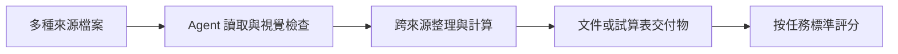

<!-- paper-reading-no-body-figures: The technical report states © 2026 Google, All rights reserved; no permission to reuse its original figures was provided. -->

## 論文要解決什麼：評估能交付工作的多模態 Agent

不少多模態基準會問模型看懂一張圖沒有，或能否根據文件回答一題。專業工作卻常需要連續做多步：讀取簡報和 PDF、比較圖表、找出衝突、計算數字，再交付一份可供他人使用的試算表、文件或簡報。MKA（Multimodal Knowledge Agent）把這種端到端任務當成評估單位，觀察 Agent 能否在資料分散、形式不同的情況下完成要求，而不是只看文字答案是否正確。

論文是 Google DeepMind 於 2026 年 11 月 10 日發布的技術報告，尚非同儕審查論文。原文 Figure 4 的 workforce planning 範例有助理解：Agent 需要從兩張不同的流程圖讀取人力安排資訊，綜合後建立試算表。這裡的難點不是單張圖辨識，而是把視覺線索帶進跨來源推理，並留下符合需求的工作產物（§3、Figure 4）。

本文依原報告解釋測試設計與作者結果。原文聲明 © 2026 Google、保留所有權利；沒有找到允許重製圖表的授權，因此以下用文字與原創流程圖講解，不複製論文圖表。完整基準資料也不公開，公開 Showcase 僅有 10 個任務範例。

## 從資料夾到交付物：任務為何需要多模態

MKA 包含 200 個專業任務，橫跨 10 個產業領域和 83 種職業，輸入總計 1,459 個檔案；88% 的任務要求產生可獨立使用的交付物（§3、Table 1）。輸入可包括文件、表格、簡報、圖片和網頁等。研究者為任務提供一個資料夾與工作指示，Agent 在其中檢查來源、使用工具、整理資訊並輸出成果。

以 workforce planning 為例，兩張流程圖可能各自呈現團隊或職務的一部分。若只依 OCR 文字回答「總共需要幾人」，可能忽略圖中的連線、階層或分組；若把每個文件分開摘要，也不一定能將它們合併到正確的表格列。任務結果因此同時受到視覺閱讀、來源整合、工具選擇與交付品質影響。這是原文案例在方法上的意義，不代表每一題都要求相同的視覺推理。

此圖是本文對論文任務流程的概念整理，不是論文圖，也不代表每個任務都採用完全相同步驟。

把 Figure 4 的例子走一遍：任務先給一份資料夾和交付要求，Agent 讀取第一張流程圖，辨認其中的職務或人力關係；接著讀第二張圖，找出需要合併的部分；然後把兩份視覺資訊對齊，寫入試算表，最後交出檔案供 rubric 檢查。若第一張圖的連線讀錯，後續加總即使算術正確仍會錯；若圖都讀對卻漏掉試算表欄位，結果也不符合完整要求。這個逐步示意忠於原文顯示的多圖到試算表任務形狀；它不是論文另外報告的單題追蹤紀錄，也不代表作者曾以此例做錯誤消融。

## WSR 與 Climb：不只計算一個總分

每個任務由多項明確評分準則（criteria）描述，評分者依交付物檢查各項要求，再彙整為加權滿意度比率 WSR（weighted satisfaction rate）。WSR 表示符合加權準則的程度，不是完成任務的比例，也不是使用者滿意度調查。Overall WSR 涵蓋全部準則；Climb WSR 則聚焦既有模型面板尚未穩定解決的準則，讓比較更集中在基準希望衡量的前沿能力（§3.2、Table 2–3）。

論文把每個準則交給固定的上一代模型面板多次作答；若面板中至少三分之二的模型能在至少三分之二的執行中通過，該準則歸為 Regression，其餘歸為 Climb。這套分類是以該面板和其執行設定作為參照，並非「所有已知模型都能做到」的普遍難度標籤。它讓基準有一個可操作的前沿定義，也使分數依賴面板選擇與通過門檻。

| 指標 | 在回答什麼問題 | 不能直接解讀成什麼 |
| --- | --- | --- |
| Overall WSR | 模型符合整體任務準則的加權程度 | 完整任務成功率或生產力提升比例 |
| Climb WSR | 模型符合面板未穩定解決之準則的加權程度 | 通用推理能力或對所有工作都較強 |
| Regression WSR | 模型符合面板已較穩定解決之準則的加權程度 | 已經無需再評估的簡單任務 |

> **花花的工程提醒**：WSR 是多個準則加權後的表現；判讀分數時，也要看哪些高權重要求沒有達成。

論文 Table 3 報告的代表結果中，Fable 5.2 得到 56.56% Climb WSR 與 73.26% Overall WSR；Gemini 4 Carbon 為 54.34% 與 71.89%；Claude Opus 為 53.01% 與 70.98%；GPT-6 Astra 為 50.24% 與 69.34%。這些都是作者在同一 benchmark 設定下的結果，不應直接推論為一般辦公工作中的模型排名或整體產品優劣。每個模型每道題只執行一次，故也沒有從重複執行估計 Agent 本身的波動。

權重也會改變讀法。若某任務有多個高權重準則，漏掉其中一項可能讓 WSR 明顯下降；通過不少低權重準則則未必抵銷這個差距。因此，WSR 適合比較該任務 rubric 下的準則達成程度，但不等於每個任務都被完整完成。Climb 與 Regression 是準則層級的切分，並非把整題貼成「容易」或「困難」。讀者最好一起看 Overall 與 Climb，再回到準則定義，而不要只拿一個百分比當總體能力。

比較時要保留兩個層次：模型排序描述的是這批任務和權重下的平均準則表現；Climb 分數則依先前模型面板劃定的準則集合計算。若面板或通過門檻不同，哪些準則列入 Climb 也可能改變。故作者的 Climb 比較能回答「在這個基準所定義的前沿準則上，這些系統表現如何」，不會自動回答「哪個模型適合某個組織」。後者還需要該組織的任務分布、錯誤代價、隱私政策、工具權限與人類覆核方式。

基準的任務數量也不能取代任務代表性。200 題分布在多領域與多職業，比單一領域測試更廣，但仍是研究團隊選定的任務集合；它未必按真實工作量或錯誤成本加權。88% 需要獨立交付物，表示這些任務常要求一個可檢查的產物，並不代表每份產物都經由實際客戶或職場使用者驗收。讀者可把 MKA 看成一種較豐富的能力探針，而不是某個職業的完整工作模擬。

## 證據地圖：結果支持什麼，還有哪些是推論

**論文直接支持**：Table 1 描述任務規模與交付物類型；Table 3 報告模型在 Overall、Climb 與 Regression 等準則集合上的 WSR；Table 5 比較移除 Gemini 4 Carbon 視覺工具前後的分數及 token、回合變化；§6 說明每題單次執行、評分器和視覺消融範圍等限制。以上是作者在報告設定中的測量結果。

**作者的主張**：MKA 將基準推向多模態、端到端的專業工作，使評估不只看文字問答，而可檢查 Agent 處理真實形式輸入和交付物的能力。任務數量、模型比較與消融為此提供實證支持，但不能由此證明基準涵蓋所有職業或任務。

**Bloss0m 的工程推論**：把來源、工具軌跡、計算和交付物一併保留下來，能讓團隊更容易定位 Agent 的錯誤類型；這是根據 MKA 的評估設計推導的做法，論文並未直接比較「保存完整軌跡」是否改善生產系統除錯。

## 視覺工具消融揭示任務差異

作者在 Gemini 4 Carbon 上進行視覺工具消融：移除 `view_image` 後，MKA Climb WSR 下降 5.94 個百分點，Overall WSR 下降 4.58 個百分點。執行回合數增加到 1.28 倍，輸出 token 為 1.40 倍、輸入 token 為 1.85 倍（§4.3、Table 5）。這組結果支持一個具體觀察：在 MKA 的任務和這個 Agent 設定中，可直接查看圖像與圖表的工具有助於表現，也可能降低以文字往返補救的成本。

同樣的視覺工具移除，在 GDPval Overall WSR 上只差 0.08 個百分點，作者稱差異不顯著。這個對照很重要：視覺工具不是每個 benchmark 都帶來相同收益；MKA 的多來源工作中確有依賴視覺資料的任務，而以其他型態工作為主的基準可能不會呈現同樣效果。這項消融只測 Gemini 4 Carbon，不能代表其他模型或所有視覺工具。

還要留意消融比較的邏輯範圍。它把同一個 Agent 設定中的視覺工具拿掉，觀察整體 benchmark 指標和資源使用的變化；因此可支持「這個工具在這批任務上有幫助」的說法。它不能單獨指出是哪類圖片、哪個推理步驟或哪一題貢獻了分數差，也不能證明有無視覺工具以外的條件完全相同到足以涵蓋其他 Agent。若工程團隊想決定哪些任務必須提供影像理解，仍需按自身任務類型做分層評測，而非直接套用該 benchmark 的平均差異。

此外，表中的分數是按 criteria 加權的 WSR，回合與 token 是成本觀察值。它們不等於工作耗時、金錢成本或人類完成時間；不同模型與工具的價格、並行方式及產物審查成本，都還需要另行測量。單看準確率或 token，無法判定哪一種配置對某個團隊最划算。

工程上可把結果轉成待驗證問題：哪些任務真的要看圖、移除視覺工具後是否能由其他工具補足、額外 token 是否值得分數改善？MKA 提供了問題方向與一個模型上的測量例子，答案仍需在自己的任務集合中測得。

對實作者來說，消融還提示了工具介面的問題：若 Agent 只能取得 OCR 文字，流程圖的箭頭、空間排列和分組資訊可能在輸入端就已經遺失；若可呼叫視覺工具，則仍要確認它實際看了哪張圖、是否放大重要區域，以及整理後的資料是否保留來源。這些是根據任務形式提出的設計檢查點，MKA 沒有逐一比較不同 OCR 或視覺工具，因此不應把它們說成論文已驗證的最佳做法。

## 評分如何連接交付物與研究結論

MKA 使用任務專屬 rubric 評估輸出，再以自動評分流程彙整準則結果（§3.2）。作者報告以 50 個任務進行人工與自動評分一致性研究，並說明其抽樣和比較方式；這是評分器品質的有限檢查，不足以保證所有 200 題、所有準則或不同領域都同樣可靠。論文亦指出評分者可能受交付物呈現影響，且某些格式或內容需要更細緻的判斷（§5）。

人工一致性樣本是對評分流程的抽查，不是把整個基準改成專家逐題裁定；因此它增加對自動分數的信心，但不能消除 rubric 定義或自動評分本身可能帶來的偏差。閱讀高分時，應將它視為「在既定評分規則下符合了較多加權條件」，並連同人工核對範圍一起解讀。這也說明 benchmark 的品質不只取決於任務像不像真實工作，還取決於評分器能否穩定地判定交付物是否符合要求。

結果真正支持的是：在這套固定任務、工具和 rubric 上，不同模型在多步驟專業任務中的加權準則表現不同；移除一個視覺工具對 MKA 的表現有可觀察影響。結果並未直接建立這些差異會轉化為企業生產力、客戶價值或實際職業表現。基準裡的任務可能接近專業工作形式，但仍是研究設計下的任務，交付物也由指定評分流程判斷。

### 重現與外推的界線

MKA 的完整 200 題集合並未公開。Google DeepMind 提供 10 個 Showcase 任務，可用來理解任務風格，但不能重建整體 benchmark 分布或重算完整分數。作者使用的 Stirrup harness 有公開程式碼；Artificial Analysis 也表示以相同 harness 獨立評估 MKA。這些資源能支持部分方法檢視與有限的外部評測，但不是完整私有測試集的獨立重跑。

實驗還有幾個直接影響解讀的限制（§6）：每個模型在每個任務上只跑一次，信賴區間反映任務抽樣而非執行間波動；自動評分器本身仍可能有誤差；視覺消融只覆蓋一個模型；允許網路存取時，Agent 可能取得資料夾外的資訊。因此，分數能比較報告中的設定，卻不能量化同一 Agent 重跑的穩定性，也不能單獨證明 Agent 只靠任務輸入完成了工作。

截至 2026 年 11 月 16 日，公開的 Showcase 資料集可讀取，授權標示為 Apache 2.0，範圍為 10 個任務；Stirrup 程式碼倉庫公開，報告記載使用 v0.2.1。它們足以讓讀者查看部分任務與執行框架，但不包含完整 200 題評測集，也不代表可精確重算報告中的所有總分。Artificial Analysis 的頁面提供外部評估入口，屬額外的外部檢查；其具體結果與資料可用性應以頁面當前說明為準，不能視作完整私有集合的獨立複製實驗。

## 對多模態 Agent 工程的啟發

MKA 把「看懂圖片」放進一個更接近工作流程的問題：Agent 能否把圖像證據與其他材料接起來，最後產生可檢查的結果。對系統設計者而言，這表示評測不應只收集最後一句文字答案，也要保存中間來源、工具呼叫、計算過程與交付物，才能辨別錯誤出在視覺擷取、資料整合、計算還是輸出格式。

但這是由論文設計推導出的工程建議，而非作者直接驗證的部署準則。實務採用前，可先用公開 Showcase 了解任務形狀，再建立符合自身文件、圖表、權限與審查要求的內部測試；重複執行、人工抽查與網路隔離也應依工作風險另外設計。不要把一個 benchmark 分數當成 Agent 已可獨立承接工作的證明。

## 主要來源與延伸閱讀

- [MKA 技術報告 PDF](https://storage.googleapis.com/deepmind-media/papers/mka_tech_paper.pdf)，Google DeepMind，2026-11-10，§3、Table 1–3、§4.3/Table 5、§6。
- [Google DeepMind 專案介紹](https://blog.google/innovation-and-ai/models-and-research/gemini-models/multimodal-knowledge-agent-benchmark/)，介紹 MKA 與公開範例。
- [公開 MKA Showcase 資料集](https://huggingface.co/datasets/google/multimodal-knowledge-agent)，10 個任務範例；不是完整 200 題測試集。
- [Stirrup 評測 harness](https://github.com/ArtificialAnalysis/Stirrup)，論文使用的 Agent 執行工具，報告記載版本 v0.2.1。
- [Artificial Analysis 的 MKA 評測頁](https://artificialanalysis.ai/evaluations/mka)，外部評測入口；其方法與完整資料可用性應按該頁說明個別判讀。

原文 Figure 4 的 workforce planning 範例提供具體任務脈絡；本文的流程圖是 Bloss0m 依論文流程自製的概念示意，沒有重製原圖。由於原文聲明保留所有權利，本文不嵌入原始論文圖表。
