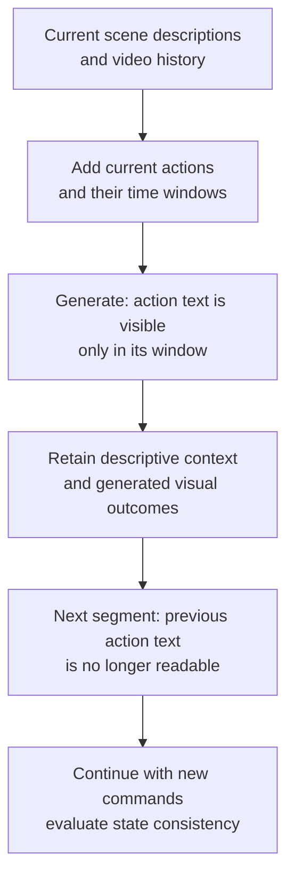

<!-- paper-reading-no-body-figures: Source-figure inventory for arXiv:2610.36729v1 (Figures 1–21), checked 2026-10-29: no confirmed reuse grant covering the material paper figures was located in the paper, arXiv license or official repository license. No original-paper images are reproduced; original mechanism diagrams are explanatory only, not source evidence. This records unresolved reuse status and does not claim reuse is prohibited. -->

This reading follows the [arXiv v1 technical report](https://arxiv.org/html/2610.36729v1), submitted October 27, 2026. This article reports the authors' experimental results; it does not provide an independent reproduction.

An interactive world has an awkward requirement: what happened in the previous turn should persist, while the previous command should stop being issued. After a robot arm places an apple on a plate, turning the camera should preserve the visible consequence—the apple is now on the plate—rather than trigger another grasp. Hy-Nomas separates **descriptions of what persists** from **instructions for what happens when**, then aligns data annotations, attention masks and the inference interface with that distinction.

This is more specific than simply extending memory. It also has a clear boundary: restricting a command's scope can help video continuity without establishing a queryable, verifiable and persistently correct three-dimensional world state. The paper's own spatial-memory comparison shows why continuous generation and faithful revisitation are different capabilities.

## From a grasp to looking away and returning

The authors' examples in [Figure 12 and Section 7.3](https://arxiv.org/html/2610.36729v1#S7.SS3) include grasping, lifting and bringing an apple to a plate. The following extends that kind of manipulation into a **Bloss0m teaching illustration, not a measured rollout**: initialize a table, plate and apple; request “pick up the apple, then put it on the plate”; turn the camera right in the next turn; finally return to the table.

An ordinary prompt can mix background with actions. If every subsequent segment continues to see that same text, “pick up” can keep influencing the picture. If all history is discarded instead, the table's position, the arm's appearance and the apple's new location may disappear. Hy-Nomas first separates these signals in its training annotations. Video-level fields specify style, perspective, persistent subject IDs and static profiles anchored to the first clear appearance. Segment-level fields specify an initial scene or changes relative to the preceding segment. Actions separately record start/end times and visible outcomes. Later descriptions need not repeat unchanged context; action intervals are chronological, non-overlapping and contained within their segment ([Section 2.4, Figures 3–4](https://arxiv.org/html/2610.36729v1#S2.SS4)).

In the illustrated manipulation segment, lifting and placing therefore occupy separate windows. When the camera turns away, generated video can still supply evidence that the apple moved, while the old action text no longer instructs the next segment to repeat the move. Whether the apple remains on the plate upon returning is a separate measured capability. The text mask itself supplies no object-permanence guarantee.

## The attention mask decides which past remains readable

Hy-Nomas adapts HunyuanVideo 1.5 into an 8B autoregressive diffusion transformer. Autoregression operates over **video segments**: generate one segment, then store text and video keys/values as context for later segments. Attention is bidirectional within a segment and causal across segments: current and past segments are visible, future segments are not. This is not fully frame-by-frame unidirectional generation ([Section 3.1, Figure 6](https://arxiv.org/html/2610.36729v1#S3.SS1)).

Segment-wise causal attention alone leaves two errors observed by the authors: actions can occur too early or out of order within a segment, and past actions can recur in later segments. Action-aware causal attention further divides each segment's text into an environmental descriptive **head** and individual action **tails**. A tail is time-scoped action text, not the final frames of the video.

| What the current query needs | Visible conditions | Error targeted |
| --- | --- | --- |
| Frames within an action window | Text for the corresponding action and that segment's descriptive head; video history remains governed by segment causality | Another action appearing prematurely or in the wrong order |
| Scene continuation in later segments | Accessible current/past descriptive heads and video history; earlier action tails are masked | Past action text reissuing an instruction |
| A new action in the next turn | The new segment's action tail during its corresponding window | Confusing a new instruction with a completed one |

It is therefore misleading to summarize the method as forgetting all historical actions. **The historical action instruction loses direct visibility; its visual consequences can remain in the video cache.** Figure 6 separately depicts video-to-video, video-to-text, text-to-video and text-to-text attention. The action-tail text loses access eligibility; historical tokens are not all erased. Descriptive heads remain available downstream, while the current action tail has its corresponding temporal window.

*Bloss0m original explanation, organizing the lifetime of conditions from [Section 3.1 and Figure 6](https://arxiv.org/html/2610.36729v1#S3.SS1). This illustrates visibility rules, not an original paper figure, module execution order or measured evidence. Retaining visual outcomes does not guarantee their correctness.*

These are information-access restrictions, not physical laws. If the generator places the apple incorrectly, the cache can carry that mistake forward. [Section 1](https://arxiv.org/html/2610.36729v1#S1) explicitly distinguishes temporal causal information flow from physical causality: preventing access to the future does not establish correct contact, collision or force effects.

## Turning a short request into the next segment

In the illustration, “put it on the plate” is a short request. The generator still needs to resolve the subject, the plate, the state to preserve and the next segment's duration. **Prompt Enhancer (PE)** performs this translation. PE is distinct from the DiT's text encoder and does more than embellish wording. It consumes the current input, earlier user/PE dialogue and generated videos, producing a dense caption aligned with the training format. The first turn establishes subjects and the scene. Later text turns emit `description_change` and `contained_actions`. Camera turns emit environmental changes with an empty action array; a separate camera trajectory goes to the DiT ([Section 6.1, Figure 9, Equation 8](https://arxiv.org/html/2610.36729v1#S6.SS1)).

PE is supervised-fine-tuned from Qwen3.8-27B using multi-turn multimodal conversations. The frozen internal text encoder is **Qwen2.5-VL-7B**, followed by a two-layer timestep-conditioned token refiner. Their sizes and roles should not be conflated. Dual-stream MMDiT blocks process video and text separately. DCAE-V compresses video into spatiotemporal latents, with each latent position becoming one token. The model denoises in this smaller representation and decodes the result into frames ([Section 3, Table 1, Equation 1](https://arxiv.org/html/2610.36729v1#S3)).

Camera input has its own path. Keyboard translation and rotation are accumulated into per-frame camera-to-world poses. The model represents relative motion between adjacent frames within each segment, aligning camera tokens with video latent frames. In every MMDiT block, video tokens query temporally aligned camera keys/values through cross-attention. Translation and rotation are continuous, but this segment-local representation does not depend on preceding global poses. It should not be mistaken for a drift-free persistent global map ([Section 3.2, Equation 3](https://arxiv.org/html/2610.36729v1#S3.SS2)).

Training requires more than changing a mask. ViPE estimates camera trajectories for selected videos, followed by filters for unreliable motion and calibration. VLM annotations track subjects, scenes and timed actions across segments. Camera-description text is removed in trajectory-conditioned paths to prevent it becoming a shortcut. Mixing text- and camera-conditioned segments teaches one generator to alternate between those interfaces (Sections 2.3–2.4 and 3.2).

The curriculum in [Table 2 and Sections 5.1–5.5](https://arxiv.org/html/2610.36729v1#S5) progresses through latent-space adaptation; segment-causal, action-aware and camera-conditioned continual pre-training; high-quality annealing; segment forcing; and diffusion distillation. Segment forcing writes the model's own low-noise predictions into history so later training segments encounter imperfect context. Each segment backpropagates immediately and releases its intermediate graph, with accumulated gradients applied after the sequence. Distillation uses causal PCM initialization followed by DDMD and adversarial refinement, reducing the author-reported sampling budget from 100 to 4 network evaluations per segment. Data, masking, PE and generated histories jointly constitute the system; end-to-end gains cannot all be assigned to one component.

## What the human comparisons actually ask

Hy-Nomas-Bench contains 280 cases split across four tasks. Not every reported percentage has 280 cases as its denominator. Groups of three trained annotators discuss and calibrate criteria, then make pairwise win/tie/loss judgments from Hy-Nomas's perspective. Net win rate is wins minus losses in percentage points. It is neither task-success rate nor a measure of generation speed ([Sections 7.1–7.2, Figure 10](https://arxiv.org/html/2610.36729v1#S7.SS1)).

| Task | Cases and interaction length | Evaluation target |
| --- | --- | --- |
| Bench-1: multi-turn text | 60 scenarios, 2–6 turns | Prompt following and physical plausibility |
| Bench-2: camera navigation | 100 trajectories; a fixed action for 2–4 seconds followed by an equal-duration inverse | Camera control across 8 basic keys and 24 non-opposing two-key combinations |
| Bench-3: interleaved control | 60 scenarios, 2–7 segments | Prompt following, physical plausibility and camera control across text/camera transitions |
| Bench-4: spatial memory | 60 first-person scenarios, 8 segments and 4 outbound/return pairs each | Identity/appearance of a static anchor, surrounding layout and spatial relationships |

Interface differences qualify the comparison. Models requiring an initial image receive Hy-Nomas's first generated frame. Native resolutions and default inference configurations are not a fully matched compute budget. In this study, Genie 3's official API lacks free-form text interaction, so it is evaluated only on Bench-2 and Bench-4. HappyOyster uses Directing for text and Wandering for navigation, without a Bench-3 result for interleaving within the same video. The authors adapt open-source LingBot-World v2 for free-form text and interleaved evaluation; its original text-control route selects among VLM-generated proposals for the next step ([Table 3, Sections 7.2–7.3](https://arxiv.org/html/2610.36729v1#S7.SS2)). An inapplicable cell is not a failure score.

On Bench-1's 60 scenarios, wins/ties/losses against HappyOyster-Directing are **65.0%/25.0%/10.0%** for prompt following and **45.0%/43.3%/11.7%** for physical plausibility. Against adapted LingBot-World v2, the corresponding results are **75.0%/16.7%/8.3%** and **68.3%/26.7%/5.0%**. A 45.0% win rate can still give a positive net win because many comparisons tie; exceeding half is not the relevant threshold ([Figure 13](https://arxiv.org/html/2610.36729v1#S7.F13)).

On Bench-2's 100 shared trajectories, wins/ties/losses against Genie 3 are **32.0%/54.0%/14.0%**. Most comparisons tie and the margin is smaller than for text tasks ([Figure 15](https://arxiv.org/html/2610.36729v1#S7.F15)). Bench-3 compares only with adapted LingBot-World v2 on 60 scenarios: **75.0%/16.7%/8.3%** for prompt following, **73.3%/25.0%/1.7%** for physical plausibility and **26.7%/68.3%/5.0%** for camera control ([Figure 16](https://arxiv.org/html/2610.36729v1#S7.F16)). This supports an end-to-end interaction advantage under these evaluation conditions, not universal superiority across world models and interfaces.

The **distinction between evidence and explanation** matters. The authors hypothesize that captions and attention contribute to the gains. Version 1 does not isolate the action-aware mask with a comparison holding data and training budget constant. Human preference evaluates the whole system. The report also lacks enough per-case rating records, blinding/presentation-order details, inter-rater statistics and confidence intervals to turn rounded percentages into a precise general ranking. Three annotators are not three independent random seeds.

## Returning to the table tests a different memory

Return to the illustrated scene. Even without repeating “pick up,” looking away and returning could change the plate, apple count or table layout. Bench-4 targets that problem using static anchors and known outbound/return trajectories, comparing initial and revisited frames at matching poses ([Figure 11, Section 7.1](https://arxiv.org/html/2610.36729v1#S7.F11)).

Across its 60 scenarios, Hy-Nomas records **13.3%/56.7%/30.0%** wins/ties/losses against Genie 3, a **−16.7 percentage-point** net win. Against HappyOyster, the rates are **30.0%/46.7%/23.3%**; against LingBot-World v2 they are **58.3%/40.0%/1.7%** ([Figure 17, Section 7.3](https://arxiv.org/html/2610.36729v1#S7.F17)). Better text following does not automatically produce the strongest spatial memory. In Figure 18's selected red-toolbox example, Hy-Nomas and Genie 3 preserve the closed state while LingBot changes it to open. A selected example does not overturn the aggregate comparison.

The authors suggest Genie 3's Street View grounding might help and propose more looped camera trajectories as future work. Neither is established as the cause by this experiment. Bench-4 largely concerns static anchors and scene revisitation; it does not solve every state change outside the field of view. The clock example in [Section 9](https://arxiv.org/html/2610.36729v1#S9) makes that distinction sharp: ten minutes after leaving a room, the clock should keep its identity and position but show a later time. Retrieving its old image can restore appearance while restoring an outdated time. The paper discusses an agentic system coordinating geometry, images, text, state updates and generation tools. That remains a research direction rather than an explicit-state guarantee already implemented by Hy-Nomas.

## Adaptation and memory savings have costs

The authors recommend training LoRA on the non-distilled autoregressive model and merging the adapter into its distilled counterpart. Avoiding another distillation run does not ensure every capability improves. In the cinematic LoRA comparison against the distilled baseline, Bench-1 prompt-following wins/losses are **35%/24%**, and physical-plausibility wins/losses are **46%/13%**. Bench-2 camera control regresses to **19%/37%**. Limited camera-trajectory diversity in the fine-tuning set is the authors' hypothesis, not an isolated ablation finding ([Sections 5.6 and 7.4, Figure 20](https://arxiv.org/html/2610.36729v1#S7.SS4)). The robotics adaptation uses 128 samples and shows preliminary generated videos, not real-robot task-success rates.

PE evaluation also uses a different metric. [Figure 21 and Section 7.5](https://arxiv.org/html/2610.36729v1#S7.SS5) compare Hy-Nomas-PE with original Qwen3.8-27B and Kimi-K3 using rank-gap-weighted human votes. Its denominator should not be treated as identical to every earlier pairwise win rate. The authors separately report near-100% format compliance versus approximately 50% and 70%, but the format-test sample denominator and uncertainty are insufficiently specified for a precise universal API-reliability claim. Valid formatting also does not establish correct scene or action interpretation.

Single-RTX-4090 video inference uses INT8 weights and historical KV storage, bounded GPU history and CPU offload, with BF16 computation after dequantization. Older history can reside on CPU: bounded GPU cache does not bound the CPU archive, current-segment size or end-to-end latency. The paper's specific example reports **20.53 GiB** peak GPU memory for a 100-second video across 7 segments at 1280×704 and 24 FPS. That is not a measurement of generating 24 frames per second ([Section 6.2](https://arxiv.org/html/2610.36729v1#S6.SS2)).

The paper describes distillation to 4 network evaluations per segment, while the official offline preset on October 29, 2026 uses 8 DiT denoising steps. PixelUMM decoding has its own separate schedule. These settings should not be merged into a single experimental configuration. The single-GPU preset selects at most 18 historical latent frames and inherits the standard configuration. The paper describes sparse attention, but the current standard preset sets it to `enabled: false`; optional optimizations cannot all be counted as default performance ([single-GPU preset](https://github.com/Tencent-Hunyuan/Hy-Nomas/blob/main/configs/experiment/single_gpu_low_mem_inference.yaml), [standard preset](https://github.com/Tencent-Hunyuan/Hy-Nomas/blob/main/configs/experiment/inference.yaml)).

## Bloss0m engineering judgment: specify the continuity you need

The most transferable design is expressing effective time consistently across data and interface. Persistent context, observed consequences and current commands have different lifetimes. That offers an interpretable control strategy for interactive-video prototypes. Evidence remains insufficient to treat the model as a faithful simulator for verifiable object state, collisions, executable robot actions or long-term spatial invariants.

> **Huahua's engineering note**
>
> An apple not being picked up again only shows that the old command did not visibly replay. Whether it remains on the correct plate still requires separate checks of revisitation, identity, count and layout. Test these requirements separately.

The engineering inference here is to separate acceptance criteria for following new commands, preserving action consequences, returning to old locations and correctly updating off-screen state. This is Bloss0m's synthesis of the evaluation gaps, not an additional benchmark defined by the authors. Attractive clips and continuous demos can motivate research; they cannot supply evidence of stable world state on their own.

## Artifacts and reproduction scope

As of October 29, 2026, the [official repository](https://github.com/Tencent-Hunyuan/Hy-Nomas) contains training, inference, captioning and web-demo code. The [weight tree](https://huggingface.co/tencent/Hy-Nomas/tree/main) lists DiT, VAE and PE components, including a concrete distilled-DiT safetensors file. [Hy-Nomas-Bench](https://huggingface.co/datasets/tencent/Hy-Nomas-Bench) supplies four case groups and corresponding camera-trajectory resources. Inspectable artifacts do not establish release of the full training corpus or independent reproduction of the comparison scores. The official captioning harness also has an integration gap: its encoder expects existing prompts and boundaries, while the captioning CLI uses fixed-duration segments rather than automatically consuming event-segmentation output. The complete preparation workflow is not a one-command reproduction pipeline.

The model and benchmark were not rerun for this article; experimental conclusions remain bounded by the paper’s settings. Deployment requires Linux, compatible NVIDIA/CUDA resources and matching checkpoints. The interactive demo's PE is a separately served component; the single-GPU video-inference claim does not cover the full PE service. Code and weights are labeled Apache-2.0, while third-party components retain their terms.

## Primary sources

- [Full arXiv v1 report](https://arxiv.org/html/2610.36729v1): data and mechanism in Sections 2–6; human evaluation in Section 7; memory and world-state boundaries in Section 9.
- [Version 1 PDF](https://arxiv.org/pdf/2610.36729v1): Figures 6, 13, 15–18 and 20–21; Tables 1–3.
- [Official code, configurations and deployment guide](https://github.com/Tencent-Hunyuan/Hy-Nomas), [model artifacts](https://huggingface.co/tencent/Hy-Nomas) and [benchmark](https://huggingface.co/datasets/tencent/Hy-Nomas-Bench): interfaces and reproduction materials.
