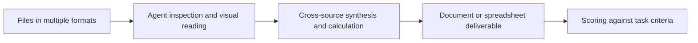

<!-- paper-reading-no-body-figures: The technical report states © 2026 Google, All rights reserved; no permission to reuse its original figures was provided. -->

## The question: Can multimodal agents deliver professional work?

Many multimodal benchmarks ask whether a model can interpret one image or answer a question about a document. Professional work often takes several steps: inspect presentations and PDFs, compare charts, resolve inconsistencies, calculate values, and deliver a spreadsheet, document, or slide deck someone else can use. MKA (Multimodal Knowledge Agent) makes this end-to-end task its unit of evaluation. It measures whether an agent can work across sources and formats, rather than only whether a text answer is correct.

Google DeepMind released the report on November 10, 2026. It is a technical report, not a peer-reviewed paper. Figure 4's workforce-planning example makes the setup concrete: the agent must read workforce information from two different flowcharts, combine it, and create a spreadsheet. The challenge is not recognizing one image in isolation. It is carrying visual evidence through cross-source reasoning into a deliverable that meets the task requirements (§3, Figure 4).

This reading follows the report's design and author-reported results. The PDF states “© 2026 Google. All rights reserved.” No permission to reproduce its figures was provided, so the explanation uses prose and an original conceptual flowchart instead of copying a paper figure. The full 200-task benchmark is also not public; the public Showcase contains ten example tasks.

## From a folder of inputs to a deliverable

MKA contains 200 professional tasks across 10 industry sectors and 83 occupations, using 1,459 input files in total. The authors report that 88% of tasks require a standalone deliverable (§3, Table 1). Inputs can include documents, spreadsheets, slides, images, and web sources. A task gives the agent a folder and instructions; the agent inspects sources, uses tools, organizes information, and produces an output.

In the workforce-planning example, two flowcharts may each show part of a staffing plan. An answer based only on OCR text could miss the diagram's links, hierarchy, or grouping. Summarizing each file separately may also fail to place the combined information into the right spreadsheet rows. Success therefore depends on visual interpretation, source integration, tool use, and deliverable quality. That is the methodological point of the example, not a claim that every benchmark task needs the same visual reasoning.

This is an original conceptual summary of the task flow, not a paper figure; individual tasks need not follow exactly these steps.

Trace the Figure 4 example step by step: the task supplies a folder and a deliverable requirement; the agent reads the first flowchart and identifies its roles or staffing relationships; it inspects the second chart for information that must be combined; then it aligns the visual evidence, writes a spreadsheet, and submits the file for rubric evaluation. If it misreads a connection in the first chart, a later sum can be arithmetically correct and still wrong. If it reads both charts correctly but omits a required spreadsheet field, the work can still fail the full requirement. This trace follows the multi-chart-to-spreadsheet shape shown in the report. It is not a separately reported per-task execution log, nor evidence that the authors ran a failure ablation on this example.

## WSR and Climb: more than one aggregate score

Each task is described by explicit scoring criteria. Evaluators check the deliverable against those criteria and aggregate the results into a weighted satisfaction rate (WSR). WSR measures the weighted extent to which criteria are satisfied. It is neither the fraction of tasks completed nor a user-satisfaction survey. Overall WSR covers all criteria. Climb WSR focuses on criteria that a panel of earlier models did not solve consistently, concentrating comparisons on the frontier capabilities the benchmark is designed to probe (§3.2, Tables 2–3).

The report assigns each criterion to a fixed panel of previous-generation models and runs them multiple times. A criterion is classified as Regression if at least two-thirds of the panel's models pass it in at least two-thirds of their runs; the rest are Climb. This is an operational label relative to that panel and setup, not a universal claim that “all known models can do this.” The definition makes the benchmark's frontier measurable, but the scores depend on the chosen panel and threshold.

| Measure | Question it answers | What it does not directly mean |
| --- | --- | --- |
| Overall WSR | How much of the weighted task criteria does the model satisfy? | Full-task success rate or productivity gain |
| Climb WSR | How much of the weighted criteria not consistently solved by the panel does it satisfy? | General reasoning ability or superiority at every job |
| Regression WSR | How much of the weighted criteria already handled consistently by the panel does it satisfy? | Tasks that no longer need evaluation |

> **Huahua's engineering note**: WSR aggregates weighted criteria; read which high-weight requirements were missed alongside the score.

Representative results in Table 3 report Fable 5.2 at 56.56% Climb WSR and 73.26% Overall WSR; Gemini 4 Carbon at 54.34% and 71.89%; Claude Opus at 53.01% and 70.98%; and GPT-6 Astra at 50.24% and 69.34%. These are author-reported results under one benchmark setup. They do not establish a general ranking for office work or overall product quality. Each model ran only once per task, so the study does not estimate variation across repeated agent runs.

Weights also affect how to read a score. If a task has several high-weight criteria, missing one can substantially lower WSR; passing many lower-weight criteria may not close the gap. WSR is therefore useful for comparing criterion satisfaction under a task's rubric, but it does not mean every task was completed in full. Climb and Regression partition criteria, not whole tasks into “easy” and “hard.” Readers should consider Overall and Climb together and inspect the criteria, rather than treating one percentage as a complete capability measure.

Keep two levels of comparison in view: model ordering describes average criterion performance on this task set and weighting; the Climb score uses the criterion set defined by the earlier-model panel. Changing the panel or pass threshold could change which criteria count as Climb. The reported comparison answers “How did these systems perform on frontier criteria as this benchmark defines them?” It does not automatically answer “Which model fits this organization?” That requires the organization's task distribution, error costs, privacy rules, tool permissions, and human review process.

Task count also does not guarantee representativeness. Two hundred tasks across multiple sectors and occupations are broader than a single-domain test, but they remain a research team's selected task set; they are not necessarily weighted by real-world workload or error cost. The fact that 88% require a standalone deliverable means tasks often ask for an inspectable artifact. It does not mean each artifact was accepted by an actual client or workplace user. MKA is better read as a richer capability probe than as a complete simulation of any one occupation.

## Evidence map: what the results support and what remains inference

**Directly supported by the paper:** Table 1 describes task scale and deliverable types; Table 3 reports model WSR across Overall, Climb, and Regression criteria; Table 5 compares Gemini 4 Carbon with and without its vision tool, including score, token, and turn changes; §6 describes limits such as one run per task, grader scope, and the single-model vision ablation. These are measurements in the authors' reported setup.

**Authors' claim:** MKA moves evaluation toward multimodal, end-to-end professional work, looking beyond text question answering to how agents handle realistic input formats and deliverables. Task counts, model comparisons, and the ablation provide empirical support, but do not show that the benchmark covers every occupation or task.

**Bloss0m engineering inference:** Retaining sources, tool traces, calculations, and deliverables together could help a team locate an agent's error type. This is an implication drawn from MKA's evaluation design; the paper does not directly compare whether preserving full traces improves debugging in production systems.

## A vision ablation shows that task mix matters

The authors ablated the vision tool on Gemini 4 Carbon. Removing `view_image` reduced MKA Climb WSR by 5.94 percentage points and Overall WSR by 4.58 percentage points. The number of turns rose to 1.28× the original, output tokens to 1.40×, and input tokens to 1.85× (§4.3, Table 5). This supports a specific observation: in MKA's tasks and this agent setup, direct access to images and charts helped performance and may have reduced the cost of text-based workarounds.

The same tool removal changed GDPval Overall WSR by only 0.08 percentage points, which the authors describe as not significant. That comparison matters: vision tools do not yield the same benefit on every benchmark. MKA includes multi-source tasks that rely on visual information; a benchmark centered on other work may show a different effect. This ablation covers only Gemini 4 Carbon and cannot establish the effect for other models or all vision tools.

The ablation also has a bounded logic. It removes the vision tool from one agent setup and observes aggregate benchmark scores and resource use, supporting the claim that the tool helped on this task set. It does not identify which image type, reasoning step, or task contributed to the score difference, nor establish the effect for other agents. A team deciding which tasks require image understanding would need a stratified evaluation on its own task types instead of importing the benchmark's average change directly.

The table's scores are weighted criterion rates; turns and tokens are cost observations. They are not elapsed time, monetary cost, or human completion time. Prices, parallel execution, and the cost of reviewing deliverables would need separate measurement. Accuracy or token use alone cannot show which setup is more economical for a particular team.

An engineering team can turn the result into questions to test: Which tasks truly need image access? Can other tools compensate when vision is removed? Is the added token use worth the score change? MKA suggests these questions and measures one model's setup; teams still need answers from their own task set.

For implementers, the ablation also raises an interface question: if an agent receives only OCR text, flowchart arrows, spatial layout, and grouping may already be lost at input time. If it can call a vision tool, a team still needs to check which image it inspected, whether it examined important regions closely, and whether the resulting notes retain their source. These are design checks suggested by the task format. MKA does not compare OCR systems or vision tools individually, so they should not be presented as practices validated by the paper.

## How scoring connects the deliverable to the conclusion

MKA evaluates outputs with task-specific rubrics and aggregates criterion outcomes through an automated grading process (§3.2). The authors report a human–automated agreement study on 50 tasks and describe how they sampled and compared judgments. This is a bounded check on the grader, not proof that every criterion across all 200 tasks and domains is equally reliable. The report also notes that presentation can affect evaluation and some formats or content need more nuanced judgment (§5).

The human-agreement sample audits the grading process; it does not replace the automated scoring of the full benchmark with expert adjudication on every task. It adds evidence about the scores while leaving possible rubric and grader biases in view. A high score should therefore be read as “more weighted criteria satisfied under the specified scoring rules,” together with the scope of the human check. Benchmark quality depends not only on whether tasks resemble real work, but also on whether the grader can consistently determine that a deliverable meets its requirements.

The results support a limited conclusion: under these fixed tasks, tools, and rubrics, models differ in weighted criterion performance on multi-step professional tasks; removing one vision tool changes performance in this benchmark. They do not directly establish that those differences translate into enterprise productivity, customer value, or real occupational performance. Tasks may resemble professional work, but they remain benchmark tasks judged through a specified evaluation process.

### Reproduction and generalization boundaries

The complete 200-task MKA set is not public. Google DeepMind provides a ten-task Showcase that illustrates the task style but cannot reconstruct the full benchmark distribution or reproduce its aggregate scores. The Stirrup harness used by the paper has public code, and Artificial Analysis says it independently evaluates MKA with the same harness. These resources support partial method inspection and external evaluation, but they are not an independent rerun on the complete private test set.

Several limitations directly affect interpretation (§6): each model ran once per task, so the reported confidence intervals reflect task sampling rather than run-to-run agent variation; the automated grader may make errors; the vision ablation covered one model; and internet access in the sandbox may let an agent obtain information beyond the supplied folder. The scores can compare the reported setups, but they cannot quantify repeated-run reliability or prove that an agent relied only on task inputs.

As of November 16, 2026, the public Showcase dataset is accessible, marked Apache 2.0, and contains ten tasks; the Stirrup code repository is public, and the report records version v0.2.1. These resources let readers inspect some tasks and the execution framework, but they do not include the full 200-task evaluation set or enable exact recalculation of every reported aggregate. Artificial Analysis provides an external evaluation entry point and an additional check; interpret its specific results and data availability according to its current documentation, rather than treating it as a replication on the complete private set.

## What MKA suggests for multimodal-agent engineering

MKA places image understanding inside a broader workflow question: can an agent connect visual evidence to other materials and produce an inspectable result? For system builders, that suggests an evaluation should retain more than the final text answer. Keeping source references, tool calls, calculations, and deliverables helps locate whether an error came from visual extraction, source integration, computation, or output formatting.

That is an engineering implication drawn from the paper's design, not a deployment rule tested by the authors. Before adoption, a team could use the public Showcase to understand the task shape, then build internal tests that reflect its own documents, charts, permissions, and review process. Repeated runs, human audits, and network isolation also need to be designed for the risks of the specific workflow. A benchmark score alone does not show that an agent is ready to own work independently.

## Primary sources and further reading

- [MKA technical report PDF](https://storage.googleapis.com/deepmind-media/papers/mka_tech_paper.pdf), Google DeepMind, 2026-11-10, §§3, Tables 1–3, §4.3/Table 5, §6.
- [Google DeepMind project overview](https://blog.google/innovation-and-ai/models-and-research/gemini-models/multimodal-knowledge-agent-benchmark/), introducing MKA and its public examples.
- [Public MKA Showcase dataset](https://huggingface.co/datasets/google/multimodal-knowledge-agent), ten example tasks; not the full 200-task test set.
- [Stirrup evaluation harness](https://github.com/ArtificialAnalysis/Stirrup), the agent execution tool used by the paper; the report records version v0.2.1.
- [Artificial Analysis MKA evaluation](https://artificialanalysis.ai/evaluations/mka), an external evaluation entry point; interpret its methods and data availability according to its own documentation.

Figure 4's workforce-planning example supplies the task context. The flowchart in this article is an original conceptual illustration based on the report, not a reproduction of its figure. Because the report reserves all rights, no original paper figures are embedded here.
